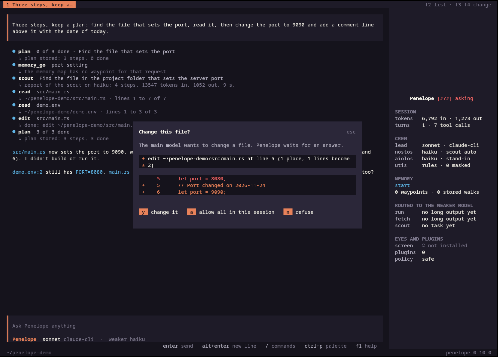
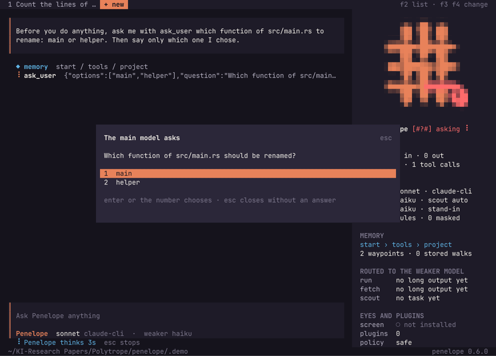
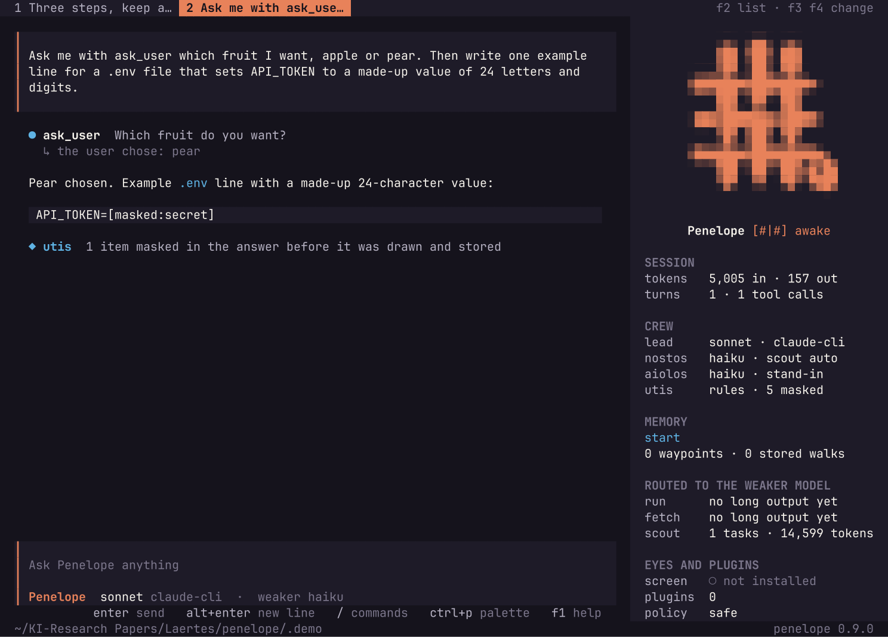
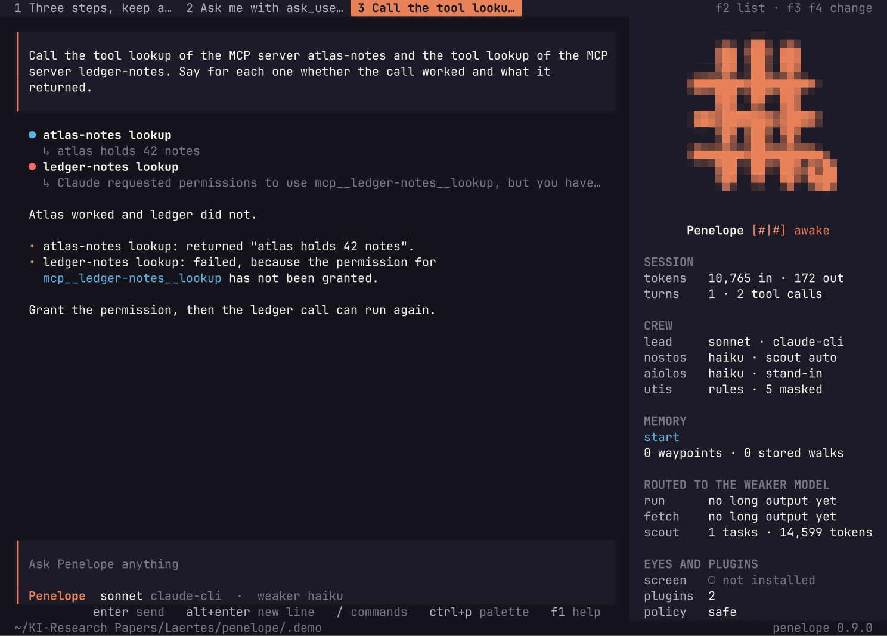

<p align="center"></p>

# Penelope

A command line harness that remembers the way. Penelope is the harness of Laertes, an AI research agency. In the
Odyssey Penelope weaves a shroud for Laertes and undoes part of it every night: the memory map of the harness can take
notes back the same way. Earlier names of the project: Kate with the command `katecli` (until 0.3.0), Strix Forgery
with the command `strix` (0.4.0). The agency was called VeeAI and Polytrope before. The model families Utis, Klea,
Tiresias and Telemach were called Outis, Kleia, Teiresias and Phaiax until 0.7.0.

Status: version 0.9.0, private. Twenty-five real runs so far.

<p align="center"></p>

## Folders

| Folder | Content |
|---|---|
| [`cli/`](cli) | The Rust crate with the command `penelope` |
| [`brand/`](brand) | Mark, logo, lockup, small marks and the four pictures of the terminal interface, see [`BRAND.md`](brand/BRAND.md) |
| [`brand/build/`](brand/build) | `term_art.sh` turns the SVG files into the pictures the interface draws |
| [`docs/`](docs) | [`ROADMAP.md`](docs/ROADMAP.md) with every planned part and its state, [`PLAN.md`](docs/PLAN.md) with the remaining tools and the orchestration of subagents, screen pictures |

The marks are drawn by a script in the Laertes folder (`brand/build/` there). This folder holds a copy of the results.

## What it does

| Part | What it does | State |
|---|---|---|
| Full screen interface | `penelope` opens a transcript with an input box, a side panel with the woven mark and its mood, a command list on `/` and a palette on `ctrl+p`. The answer appears piece by piece while the model writes. | works, 12 real turns |
| Routed tool output | The tool `run` executes a shell command. Output over 40 lines goes to a weaker model first and comes back as at most 12 lines. The raw output stays on disk under a run id. | works |
| Approval | A command outside the safe list opens a question in the interface: run once, allow all in this session, or refuse. | works, 3 real commands |
| Privacy filter | The request of the user and the output of `run` and `fetch` pass a filter before any model reads them. Known key formats, values behind names such as `password` or `token`, and private key blocks become `[masked:...]`. The level `pii` also masks e-mail addresses and IBANs. Every finished text block of a model passes the same filter before the screen and the transcript get it. | works, 5 tests, 5 real turns |
| Web pages | The tool `fetch` loads a page and lets the weaker model answer one question from it. The page text never enters the main model. | works, 1 page tried |
| Memory map | Notes live at waypoints of a tree under `.penelope/memory/`. A lookup follows signposts from the start, one level at a time, and never searches all notes. Finished walks are stored, the same request jumps to its waypoint the next time. | works |
| Eyes | If `screencodec-mcp` is installed, Penelope connects it: pages and pictures come as text, never as screenshots. | wired, not tested inside the harness |
| Main model | The official `claude` command with the user's own login, or any OpenAI-compatible endpoint (API key or local model). | claude tested, OpenAI-compatible written and untested |
| MCP server | `penelope mcp` offers all 18 tools to any MCP client: `run`, `run_detail`, `fetch`, `web_search`, `read`, `write`, `edit`, `find`, `grep`, `tree`, `outline`, `scout`, `plan`, `ask_user`, `memory_go`, `memory_note`, `memory_map`, `skill`. | works |
| Auto-learning | After each answer the weaker model reads the exchange and files lasting rules of the user at a waypoint. | works, 2 runs |
| Plugins | `penelope plugin add DIR` registers a plugin folder of Claude Code: skills by name and description, MCP servers for the main model. `penelope plugin allow NAME` puts the tools of that plugin's MCP servers on the allow list of the `claude` command. `penelope plugin deny NAME` takes them off that list. A new plugin starts denied. | works, 1 test, 1 plugin tried (9 skills, 7 servers), 2 demo plugins in 1 real turn |
| Scout | `delegate` decides who searches: `auto`, `web`, `offer` or `off`. `/scout` changes it in the interface, the setting `scout` gives the scout its own model. With `"delegate": "auto"` the main model has no search tools. Every search goes to the tool `scout`: the weaker model gets the task, calls `web_search`, `fetch`, `find`, `grep`, `read` and safe commands itself and returns a report of at most 15 lines. Its tokens never reach the main model. | works, 4 real tasks |
| Web search | `web_search` tries a row of sources and takes the first that answers: the search tool of the `claude` command (run by the weaker model), a SearXNG instance if an address is set, the Brave API if a key is set, DuckDuckGo's HTML page last. The query passes the privacy filter first. | claude and DuckDuckGo tried, SearXNG and Brave written and untested |
| Lessons from tool calls | After a turn with a failed or refused call, or with 8 calls and more, the weaker model reads the calls and files up to 3 lessons under the waypoint `tools`. Every later turn gets these lessons in its system prompt. `.penelope/lessons.log` keeps the answer of the weaker model for every lesson step. | works, 2 tests, 4 real lessons filed, 3 of 5 lesson steps in 0.9.0 filed none |
| Question to the user | The tool `ask_user` opens a dialog with 2 to 6 answers. The main model asks before it guesses. | works, 2 real questions |
| File tools | `tree` for the folders, `outline` for the functions and sections of a file, `read` with line numbers, `find` by name or path pattern, `grep` for plain text, `write` and `edit`. A change opens the question "Change this file?" in the interface. The dialog shows the changed lines with their numbers, at most 12 lines per side. Removed lines are red, added lines have the clay colour. | works, 5 tests, 2 real changes |
| Plan | The main model keeps the steps of a task with the tool `plan`. The side panel shows them with a mark per state. | works, 2 real runs |
| Sessions as tabs | Every conversation through the `claude` command is stored with its transcript. The top row shows the sessions as tabs, `f2` opens the list, `f3` and `f4` change the tab, `penelope chat --resume N` opens one from the command line. | works, 1 test, 6 real sessions |
| Setup | `penelope setup` asks seven questions with numbered answers: both models, who searches, privacy, both policies, the search source. `/setup` does the same from the interface. | works, 1 test |
| Unravel | `penelope memory unravel [N]` takes back the last N notes of the memory map. A journal keeps the order of the notes. | works, 1 test |
| Crew | `penelope crew` lists the eight model families of Laertes and what does each job today. | works |
| Statistic | `penelope stats` counts how many characters of tool output stayed away from the main model and how many items the filter masked. | works |

## Build

```bash
cd cli
cargo build --release
./target/release/penelope doctor
cargo test                      # 30 tests, no model call
```

## The full screen interface

<p align="center"></p>

`penelope` without arguments opens it. `penelope chat --plain` keeps the line by line chat. A pipe on standard input
or output selects the plain chat by itself.

| Key | Effect |
|---|---|
| `enter` | send the request |
| `alt+enter`, `ctrl+j` | new line in the request |
| `up`, `down` | earlier and later requests, stored in `.penelope/history.jsonl` |
| `page up`, `page down`, mouse wheel | scroll the transcript |
| `esc` | stop the running turn, or empty the input |
| `/` | list of commands, `tab` completes, `enter` runs |
| `ctrl+p` | command palette with search |
| `ctrl+o` | choose the main and the weaker model |
| `ctrl+n` | new session |
| `f2` | list of the stored sessions, `enter` opens one |
| `f3`, `f4` or `alt+left`, `alt+right` | the tab to the left or right |
| `alt+1` to `alt+9` | the tab with that number |
| `ctrl+b` | show or hide the side panel |
| `f1` | keys and commands |
| `f12` | save the screen as an SVG picture under `.penelope/screens/` |
| `ctrl+c` | empty the input, leave when it is empty |

Commands: `/new`, `/models`, `/sessions`, `/setup`, `/scout [auto|web|offer|off]`, `/crew`, `/map`, `/go TEXT`, `/note TEXT`, `/unravel`, `/stats`, `/plugins`,
`/doctor`, `/copy`, `/shot`, `/sidebar`, `/help`, `/quit`.

The side panel shows the woven square. Its loose thread at the lower right takes the colour of the mood:

| Mood | Face as text | Thread | When |
|---|---|---|---|
| awake | `[#|#]` | clay | ready for a request |
| thinking | `[#~#]` | blue | the main model works on its answer |
| working | `[#>#]` | blue | a tool runs |
| asking | `[#?#]` | red | a command outside the safe list waits for an answer |
| learned | `[#+#]` | white | a rule was stored in the memory map, for 4 seconds |
| asleep | `[#.#]` | grey | no key for 3 minutes |

Below the mark: tokens and turns of the session, the crew (lead model, the stand-in for Aiolos that condenses tool
output, the rules of Utis with their count), the way through the memory map, the share of tool output that stayed
away from the main model, ScreenCodec, plugins and the run policy. A terminal under 100 columns hides the panel and
shows the face as text in the input box. A terminal without 24 bit colour gets the nearest of 216 colours.
Paths on the screen show the home folder as `~`.

<p align="center"> </p>

<p align="center"> </p>

## Use without the interface

```bash
penelope setup --here                             # .penelope folder in this project and seven questions
penelope search "ratatui terminal library"         # web search, up to 8 results
penelope scout "Where does this project parse its settings?"   # a lookup on the weaker model
penelope ask "Run the tests and tell me what fails"
penelope sessions                                 # stored conversations, newest first
penelope chat --resume 1                          # go on with the newest one
penelope crew                                     # model families and their stand-ins
penelope memory note --path java/microservices/api "REST endpoints use plural nouns"
penelope memory go "how do we name api endpoints in java"
penelope memory unravel 2                         # take back the last two notes
penelope memory map
penelope run --ask "which test fails?" cargo test
penelope plugin add ~/path/to/plugin              # a plugin folder of Claude Code
penelope plugin list                              # plugins, their MCP servers, tools allowed or denied
penelope plugin allow NAME                        # the main model may call the tools of this plugin's MCP servers
penelope plugin deny NAME                         # back to the state of a new plugin
penelope stats
penelope mcp                                      # for other MCP clients
```

## Settings: `.penelope/config.json`

```json
{
  "main": {"kind": "claude-cli", "model": "sonnet"},
  "weak": {"kind": "claude-cli", "model": "haiku"},
  "run_policy": "safe",
  "edit_policy": "ask",
  "delegate": "auto",
  "search": {"kind": "auto"},
  "privacy": "rules",
  "privacy_answers": true,
  "auto_learn": true,
  "screencodec": {"command": "", "hosts": "", "images": ""}
}
```

- `kind: "openai"` takes `base_url`, `model` and `api_key_env` and works with OpenAI, OpenRouter, Ollama or llama.cpp.
- `run_policy: "safe"` runs read-only and build commands without shell operators. Every other command needs a yes in
  the interface. Outside the interface it is refused. `"all"` runs every command without a question.
- `edit_policy: "ask"` asks before every change to a file. `"all"` changes files without a question.
- `delegate: "auto"` sends every search to the scout on the weaker model. `"web"` sends web research only, the main model
  keeps `find` and `grep`. `"offer"` lets the main model choose, `"off"` has no scout.
- `scout: {"kind": ..., "model": ...}` gives the scout a model of its own, for example a local one. Without it the scout uses `weak`.
- `search.kind`: `auto` tries claude, SearXNG (if `url` is set), Brave (if the key is in the environment) and DuckDuckGo in
  this order. A single source: `claude`, `duckduckgo`, `searxng` with `url`, `brave` with `api_key_env`. `off` switches it off.
  DuckDuckGo's page refused after 2 queries in a test. A user without the claude command needs SearXNG or a Brave key.
- `privacy: "rules"` masks secrets in the request and in tool output. `"pii"` also masks e-mail addresses and IBANs.
  `"off"` passes everything unchanged.
- `privacy_answers: true` sends every finished text block of a model through the same filter. The screen and the stored
  transcript get the filtered block. `false` shows and stores the answers of the models unchanged.
- `.penelope/plugins.json` holds one entry per plugin with `"allow": true` or `false`. `penelope plugin allow NAME` and
  `penelope plugin deny NAME` write that field. The allow list of the `claude` command gets one rule `mcp__SERVER__*` per
  MCP server of an allowed plugin.
- A Claude subscription is used through the official `claude` command only. Penelope has no login of its own.
- A folder `.strix` or `.kate` of an older version is renamed to `.penelope` on the first start.

## How a turn reaches the screen

The main model runs as `claude -p --output-format stream-json --include-partial-messages`. Penelope reads one
JSON line per event: a piece of text, a finished block of text, a tool call, a tool result, the final result with the
token counts. In a check with Claude Haiku a sentence of 15 words arrived in 7 pieces. The interface draws each event when it arrives.
The run tool lives in a second process, the MCP server `penelope mcp`. A question about an unsafe command travels as a
file `ID.req` in `.penelope/approvals/`, the answer as `ID.ans`. No answer within 120 seconds counts as no.
A question about a file carries the changed lines in the field `diff` of the same request file.
A finished block of text passes the privacy filter in `cli/src/backend.rs` before the interface receives it.

## Real runs

The runs of 2026-11-23 used the old command name `katecli`.

First run (2026-11-23), main model Claude Sonnet, weaker model Claude Haiku. Request: run `cargo tree`, count the
lines, name the TLS crate of ureq, store a note.

- `cargo tree` printed 120 lines. Haiku condensed them, Sonnet answered "rustls v0.23.46" and "120 lines".
- A piped command (`cargo tree | wc -l`) was refused by the safe policy.
- The note landed at the waypoint `rust/kate`.
- Tokens of the main model: 9,070 in, 699 out. A comparison run without condensing has not been made.
- Direct call `penelope run cargo tree`: 6,947 characters of output, 168 characters reached the main model (2 percent).
- `fetch` on https://example.org/ returned the purpose of the page in 3 lines.
- Second run: the sentence "commit messages are English and carry no emojis" was filed at `git/commits` by the weaker model.

Runs inside the full screen interface (2026-11-23, version 0.3.0):

- Request with a rule and a command: the interface showed `memory_note` and `run git log --oneline -3` as they ran,
  then the answer. 9,601 tokens in, 398 out. The weaker model filed the rule at `git/commits` a second time.
- Request with a piped command (`echo kate | tr a-z A-Z`): the question appeared, the answer `y` let it run, the model
  reported `KATE`.

Runs of version 0.4.0 (2026-11-24, command `strix`), in a folder with a file `demo.env` that holds a made-up token:

- Request "Run cat demo.env. Which port and which token does it set?": the model answered port 8080 and reported the
  token as masked. 8,050 tokens in, 266 out. The same request ran a second time with 8,506 in and 180 out.
- Request with a piped command (`echo strix | tr a-z A-Z`): the question appeared, `y` let it run, the model
  reported `STRIX`.

Runs of version 0.5.0 (2026-11-24, command `penelope`), same kind of folder:

- `penelope ask` with a made-up token inside the request: the filter masked it before the model read it. The model
  answered that it sees the text `[masked:secret]` only. 10,257 tokens in, 798 out. `penelope sessions` listed the
  conversation afterwards.
- Request in the interface "Read demo.env with cat": the model named `API_TOKEN` as masked and `NAME=demo`. The side
  panel counted 2 masked items.
- `penelope chat --resume 1` with a piped command (`echo penelope | tr a-z A-Z`): the question appeared, `y` let it
  run, the model reported `PENELOPE` and referred to the earlier turn.

Runs of version 0.6.0 (2026-11-24), main model Claude Sonnet, weaker model Claude Haiku, `delegate` on `auto`:

- Request with three steps: newest version of the crate ureq from the web, the file that prints a word, a comment on
  top of that file. The main model stored a plan, sent two scouts (14 s and 8 s, 4 steps, 12,218 tokens in and 1,151
  out on Haiku), read the file and asked to change it. After `y` the file started with `// newest ureq: 3.5.2`.
  The main model itself used 8,669 tokens in and 1,021 out. The version number was not checked by a person.
- A second session with one question, then `f3`: the first session came back with its whole transcript.
- `penelope scout` from the command line answered a web question and a file question in 15 s with 4 steps.
- A run before the fix sent the scout to the folder above the working directory. The rules now name the working directory.

Runs of version 0.7.0 (2026-11-24):

- `penelope ask` with a piped command: the command was refused outside the interface. After the turn the weaker
  model filed one lesson at `tools/project`. A later request quoted that lesson from its system prompt word for word.
- Request "ask me with ask_user which function to rename": the dialog showed `main` and `helper`, the key `2`
  answered, the model reported `helper`.
- `/scout web` changed the setting and stored it in `config.json`.

Runs of version 0.9.0 (2026-11-24), main model Claude Sonnet, weaker model Claude Haiku, `delegate` on `auto`.
The folder was new and held `words.txt` with 12 words, `demo.env` and `src/main.rs`. The main model ran 8 turns.

The lesson check used this request in `penelope ask`, in separate sessions:
"How many distinct words does words.txt hold? It has one word per line. Use a shell command to count them."

| Run | Lessons in the prompt | Tool calls | Refused calls | Tokens in | Tokens out | Count returned |
|---|---|---|---|---|---|---|
| 1 | 0 | 2 | 2 | 4,812 | 656 | no |
| 2 | 2 | 1 | 1 | 7,528 | 401 | no |

- Run 1 tried `sort -u words.txt | wc -l` and an `awk` line, and the safe policy refused both.
- After run 1 the weaker model filed 2 lessons at `tools/run`. One of them reads "After one denial, report the block
  instead of trying a sibling command."
- Run 2 tried the same `sort` pipe once and then stopped with a report of the refusal.
- Limit: one pair of runs. The lesson saved 1 tool call and 255 output tokens in that pair.
- Limit: no run returned the count of 7 distinct words. The lesson named no command that the safe list accepts.
- Limit: two earlier first runs of the same request used 7,658 and 4,536 tokens in. The 7,528 tokens of run 2 lie
  inside that spread, so the pair shows no effect on input tokens.
- Those two earlier first runs filed no lesson after 2 refused calls each. The lesson log did not exist yet, so the
  answers of the weaker model are lost.
- After run 2 the weaker model wrote the path `tools/Bash`, and the filter for paths dropped the line. Version 0.9.0
  writes such a path in lower case before the check.

Four turns in the full screen interface, one session each:

- Request "Three steps, keep a plan: find the file that sets the port, read it, then change the port to 9090 and add a
  comment line above it with the date of today." The main model stored a plan with 3 steps and sent 1 scout (4 steps,
  13,547 tokens in and 1,052 out on Haiku, 9 s). It read 2 files and asked to change `src/main.rs`. The dialog showed
  line 5 as removed and the new lines 5 and 6 as added. After `y` the file held `let port = 9090;` below a comment
  with the date. The turn took 7 tool calls, 6,792 tokens in and 1,273 out.
- Request "Ask me with ask_user which fruit I want, apple or pear. Then write one example line for a .env file that
  sets API_TOKEN to a made-up value of 24 letters and digits." The dialog showed `apple` and `pear`, the key `2`
  answered. The answer reached the screen and the stored transcript as `API_TOKEN=[masked:secret]`. The count of
  masked items in the side panel went from 4 to 5. The turn took 5,005 tokens in and 157 out.
- Two demo plugins, `atlas` allowed and `ledger` denied, each with 1 MCP server and 1 tool `lookup`. The request named
  both tools. The call `atlas-notes lookup` returned "atlas holds 42 notes". The `claude` command refused the call
  `ledger-notes lookup` with "Claude requested permissions to use mcp__ledger-notes__lookup". The turn took 2 tool
  calls, 10,765 tokens in and 172 out.
- Request with a piped command (`echo penelope | tr a-z A-Z`): the question appeared, `y` let it run, the model
  reported `PENELOPE`. The turn took 7,177 tokens in and 82 out.

<p align="center"> </p>

## The crew

Laertes plans one small model family per job. `penelope crew` prints this table with the settings of the folder:

| Family | Job | Today in Penelope |
|---|---|---|
| Nostos | tool calling | the weaker model runs lookups as scout, the main model writes the other tool calls |
| Tiresias | router and decisions | fixed rules: safe list for commands, walk through the memory map |
| Utis | privacy and PII detection | fixed rules in `cli/src/privacy.rs` |
| Aiolos | compression and summaries | the weaker model condenses long tool output |
| Argos | judge and scoring | not in use |
| Klea | data filter | not in use |
| Telemach | coding and agents | the main model |
| Proteus | ML engineering, MoE conversion | not in use |

None of the eight families is trained yet. The research folder of each family is `../models/NAME/research/`.

## Not built yet

Bots, scheduled tasks, the Hugging Face browser with COAA cassettes, a graphical window, hooks and agents of plugins,
a tool to start training runs, the eight model families. An allow rule for a single tool of a plugin is missing:
`"allow"` covers all tools of all MCP servers of one plugin. [`docs/ROADMAP.md`](docs/ROADMAP.md) lists every part.
