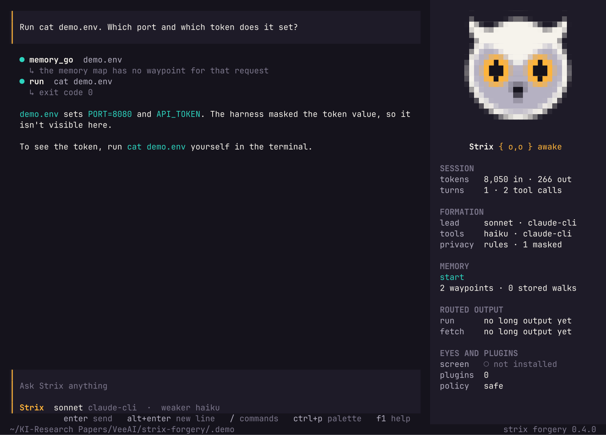

<p align="center"></p>

# Strix Forgery

Strix Forgery is a small agent harness for the command line. The command is `strix`. It is the harness of VeeAI, an
AI research agency. Until version 0.3.0 the project was called Kate and the command `katecli`.

Status: version 0.4.0, private. Eight real runs so far.

<p align="center"></p>

## What lies where

| Folder | Content |
|---|---|
| [`cli/`](cli) | The Rust crate `strix-forgery` with the binary `strix`: harness, tools, memory map, MCP server, full screen interface |
| [`brand/`](brand) | Logo, marks, mascot, six moods, banner, preview, colours and type in [`BRAND.md`](brand/BRAND.md) |
| [`brand/concepts/`](brand/concepts) | The four owl drawings the brand files are built from |
| [`brand/build/`](brand/build) | Two scripts that rebuild the brand files and the pictures of the terminal interface |
| [`docs/`](docs) | [`ROADMAP.md`](docs/ROADMAP.md) with every planned part and its state, screen pictures |
| [`design/`](design) | Link and notes for the design canvas |

## What it does

| Part | What it does | State |
|---|---|---|
| Full screen interface | `strix` opens a transcript with an input box, a side panel with the owl and its mood, a command list on `/` and a palette on `ctrl+p`. The answer appears piece by piece while the model writes. | works, 5 real turns |
| Routed tool output | The tool `run` executes a shell command. Output over 40 lines goes to a weaker model first and comes back as at most 12 lines. The raw output stays on disk under a run id. | works |
| Approval | A command outside the safe list opens a question in the interface: run once, allow all in this session, or refuse. | works, 2 real commands |
| Privacy filter | Output of `run` and `fetch` passes a filter before any model reads it. Known key formats, values behind names such as `password` or `token`, and private key blocks become `[masked:...]`. | works, 3 tests, 2 real turns |
| Web pages | The tool `fetch` loads a page and lets the weaker model answer one question from it. The page text never enters the main model. | works, 1 page tried |
| Memory map | Notes live at waypoints of a tree under `.strix/memory/`. A lookup follows signposts from the start, one level at a time, and never searches all notes. Finished walks are stored, the same request jumps to its waypoint the next time. | works |
| Eyes | If `screencodec-mcp` is installed, Strix Forgery connects it: pages and pictures come as text, never as screenshots. | wired, not tested inside the harness |
| Main model | The official `claude` command with the user's own login, or any OpenAI-compatible endpoint (API key or local model). | claude tested, OpenAI-compatible written and untested |
| MCP server | `strix mcp` offers `run`, `run_detail`, `fetch`, `memory_go`, `memory_note`, `memory_map`, `skill` to any MCP client. | works |
| Auto-learning | After each answer the weaker model reads the exchange and files lasting rules of the user at a waypoint. | works, 2 runs |
| Plugins | `strix plugin add DIR` registers a plugin folder of Claude Code: skills by name and description, MCP servers for the main model. | works, 1 plugin tried (9 skills, 7 servers) |
| Statistic | `strix stats` counts how many characters of tool output stayed away from the main model. | works |

## Build

```bash
cd cli
cargo build --release
./target/release/strix doctor
cargo test                      # 16 tests, no model call
```

## The full screen interface

<p align="center"></p>

`strix` without arguments opens it. `strix chat --plain` keeps the old line by line chat. A pipe on standard input
or output selects the plain chat by itself.

| Key | Effect |
|---|---|
| `enter` | send the request |
| `alt+enter`, `ctrl+j` | new line in the request |
| `up`, `down` | earlier and later requests, stored in `.strix/history.jsonl` |
| `page up`, `page down`, mouse wheel | scroll the transcript |
| `esc` | stop the running turn, or empty the input |
| `/` | list of commands, `tab` completes, `enter` runs |
| `ctrl+p` | command palette with search |
| `ctrl+o` | choose the main and the weaker model |
| `ctrl+n` | new session |
| `ctrl+b` | show or hide the side panel |
| `f1` | keys and commands |
| `f12` | save the screen as an SVG picture under `.strix/screens/` |
| `ctrl+c` | empty the input, leave when it is empty |

Commands: `/new`, `/models`, `/map`, `/go TEXT`, `/note TEXT`, `/stats`, `/plugins`, `/doctor`, `/copy`, `/shot`,
`/sidebar`, `/help`, `/quit`.

The side panel shows the owl with one of six moods:

| Mood | Face | When |
|---|---|---|
| awake | `{ o,o }` | ready for a request |
| thinking | `{ -,o }` | the main model works on its answer |
| working | `{ >,< }` | a tool runs |
| asking | `{ O,O }` | a command outside the safe list waits for an answer |
| learned | `{ ^,^ }` | a rule was stored in the memory map, for 4 seconds |
| asleep | `{ -,- }` | no key for 3 minutes |

Below the owl: tokens and turns of the session, the formation (lead model, model for tool output, privacy filter
with its count), the way through the memory map, the share of tool output
that stayed away from the main model, ScreenCodec, plugins and the run policy. A terminal under 100 columns hides the
panel and shows the face as text in the input box. A terminal without 24 bit colour gets the nearest of 216 colours.

<p align="center"> </p>

## Use without the interface

```bash
strix init                                     # .strix folder in this project
strix ask "Run the tests and tell me what fails"
strix memory note --path java/microservices/api "REST endpoints use plural nouns"
strix memory go "how do we name api endpoints in java"
strix memory map
strix run --ask "which test fails?" cargo test
strix plugin add ~/path/to/plugin            # a plugin folder of Claude Code
strix stats
strix mcp                                    # for other MCP clients
```

## Settings: `.strix/config.json`

```json
{
  "main": {"kind": "claude-cli", "model": "sonnet"},
  "weak": {"kind": "claude-cli", "model": "haiku"},
  "run_policy": "safe",
  "privacy": "rules",
  "auto_learn": true,
  "screencodec": {"command": "", "hosts": "", "images": ""}
}
```

- `kind: "openai"` takes `base_url`, `model` and `api_key_env` and works with OpenAI, OpenRouter, Ollama or llama.cpp.
- `run_policy: "safe"` runs read-only and build commands without shell operators. Every other command needs a yes in
  the interface. Outside the interface it is refused. `"all"` runs every command without a question.
- `privacy: "rules"` masks secrets in tool output. `"off"` passes the output unchanged.
- A Claude subscription is used through the official `claude` command only. Strix Forgery has no login of its own.
- A folder `.kate` of an older version is renamed to `.strix` on the first start.

## How a turn reaches the screen

The main model runs as `claude -p --output-format stream-json --include-partial-messages`. Strix Forgery reads one
JSON line per event: a piece of text, a finished block of text, a tool call, a tool result, the final result with the
token counts. In a check with Claude Haiku a sentence of 15 words arrived in 7 pieces. The interface draws each event when it arrives.
The run tool lives in a second process, the MCP server `strix mcp`. A question about an unsafe command travels as a
file `ID.req` in `.strix/approvals/`, the answer as `ID.ans`. No answer within 120 seconds counts as no.

## Real runs

The runs of 2026-11-23 used the old command name `katecli`.

First run (2026-11-23), main model Claude Sonnet, weaker model Claude Haiku. Request: run `cargo tree`, count the
lines, name the TLS crate of ureq, store a note.

- `cargo tree` printed 120 lines. Haiku condensed them, Sonnet answered "rustls v0.23.46" and "120 lines".
- A piped command (`cargo tree | wc -l`) was refused by the safe policy.
- The note landed at the waypoint `rust/kate`.
- Tokens of the main model: 9,070 in, 699 out. A comparison run without condensing has not been made.
- Direct call `strix run cargo tree`: 6,947 characters of output, 168 characters reached the main model (2 percent).
- `fetch` on https://example.org/ returned the purpose of the page in 3 lines.
- Second run: the sentence "commit messages are English and carry no emojis" was filed at `git/commits` by the weaker model.

Runs inside the full screen interface (2026-11-23, version 0.3.0):

- Request with a rule and a command: the interface showed `memory_note` and `run git log --oneline -3` as they ran,
  then the answer. 9,601 tokens in, 398 out. The weaker model filed the rule at `git/commits` a second time.
- Request with a piped command (`echo kate | tr a-z A-Z`): the question appeared, the answer `y` let it run, the model
  reported `KATE`.

Runs after the rename (2026-11-24, version 0.4.0), in a folder with a file `demo.env` that holds a made-up token:

- Request "Run cat demo.env. Which port and which token does it set?": the model answered port 8080 and reported the
  token as masked. 8,050 tokens in, 266 out. The same request ran a second time with 8,506 in and 180 out.
- Request with a piped command (`echo strix | tr a-z A-Z`): the question appeared, `y` let it run, the model
  reported `STRIX`.

## The formation

VeeAI plans one small model per job. The harness has the places for them:

| Place in the side panel | Job | Today | Planned model |
|---|---|---|---|
| lead | answers the request, writes code | setting `main` | Corvus for coding |
| tools | reads long tool output and condenses it | setting `weak` | Wren for tool calling |
| privacy | masks secrets before a model reads tool output | fixed rules in `cli/src/privacy.rs` | Strix |

None of the three models exists yet.

## Not built yet

Bots, scheduled tasks, the Hugging Face browser with COAA cassettes, a graphical window with the owl, hooks and agents
of plugins, a list of earlier sessions, the models Wren, Strix and Corvus. Tools of plugin MCP servers are visible to the
main model but not on the allow list yet. [`docs/ROADMAP.md`](docs/ROADMAP.md) lists every part.
