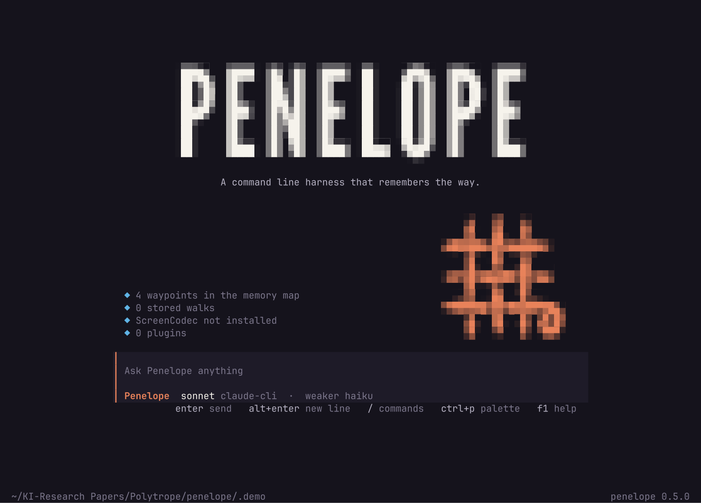
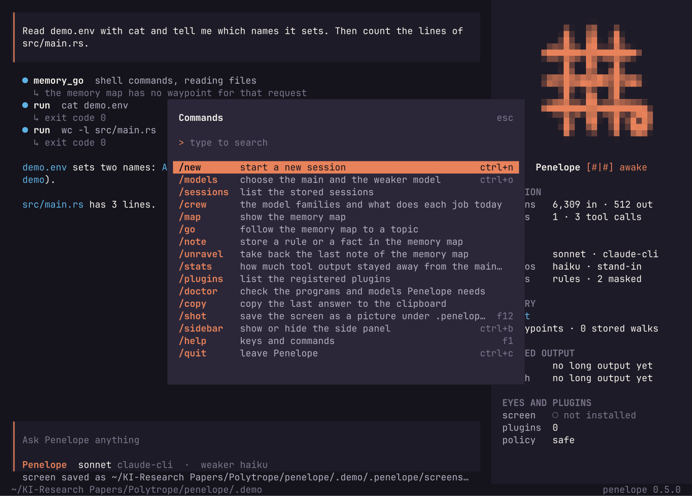

<p align="center"></p>

# Penelope

A command line harness that remembers the way. Penelope is the harness of Polytrope, an AI research agency. The name
comes from the weaver of the Odyssey, who undid part of her work every night: the memory map of the harness can take
notes back the same way. Earlier names of the project: Kate with the command `katecli` (until 0.3.0), Strix Forgery
with the command `strix` (0.4.0).

Status: version 0.5.0, private. Eleven real runs so far.

<p align="center"></p>

## Folders

| Folder | Content |
|---|---|
| [`cli/`](cli) | The Rust crate with the command `penelope` |
| [`brand/`](brand) | Mark, logo, lockup, small marks and the four pictures of the terminal interface, see [`BRAND.md`](brand/BRAND.md) |
| [`brand/build/`](brand/build) | `term_art.sh` turns the SVG files into the pictures the interface draws |
| [`docs/`](docs) | [`ROADMAP.md`](docs/ROADMAP.md) with every planned part and its state, screen pictures |

The marks are drawn by a script in the Polytrope folder (`brand/build/` there). This folder holds a copy of the results.

## What it does

| Part | What it does | State |
|---|---|---|
| Full screen interface | `penelope` opens a transcript with an input box, a side panel with the woven mark and its mood, a command list on `/` and a palette on `ctrl+p`. The answer appears piece by piece while the model writes. | works, 8 real turns |
| Routed tool output | The tool `run` executes a shell command. Output over 40 lines goes to a weaker model first and comes back as at most 12 lines. The raw output stays on disk under a run id. | works |
| Approval | A command outside the safe list opens a question in the interface: run once, allow all in this session, or refuse. | works, 2 real commands |
| Privacy filter | The request of the user and the output of `run` and `fetch` pass a filter before any model reads them. Known key formats, values behind names such as `password` or `token`, and private key blocks become `[masked:...]`. The level `pii` also masks e-mail addresses and IBANs. | works, 4 tests, 4 real turns |
| Web pages | The tool `fetch` loads a page and lets the weaker model answer one question from it. The page text never enters the main model. | works, 1 page tried |
| Memory map | Notes live at waypoints of a tree under `.penelope/memory/`. A lookup follows signposts from the start, one level at a time, and never searches all notes. Finished walks are stored, the same request jumps to its waypoint the next time. | works |
| Eyes | If `screencodec-mcp` is installed, Penelope connects it: pages and pictures come as text, never as screenshots. | wired, not tested inside the harness |
| Main model | The official `claude` command with the user's own login, or any OpenAI-compatible endpoint (API key or local model). | claude tested, OpenAI-compatible written and untested |
| MCP server | `penelope mcp` offers `run`, `run_detail`, `fetch`, `memory_go`, `memory_note`, `memory_map`, `skill` to any MCP client. | works |
| Auto-learning | After each answer the weaker model reads the exchange and files lasting rules of the user at a waypoint. | works, 2 runs |
| Plugins | `penelope plugin add DIR` registers a plugin folder of Claude Code: skills by name and description, MCP servers for the main model. | works, 1 plugin tried (9 skills, 7 servers) |
| Sessions | Every conversation through the `claude` command is stored with its first request, turns and tokens. `penelope sessions` lists them, `penelope chat --resume N` goes on with one. | works, 1 test, 1 real resume |
| Unravel | `penelope memory unravel [N]` takes back the last N notes of the memory map. A journal keeps the order of the notes. | works, 1 test |
| Crew | `penelope crew` lists the eight model families of Polytrope and what does each job today. | works |
| Statistic | `penelope stats` counts how many characters of tool output stayed away from the main model and how many items the filter masked. | works |

## Build

```bash
cd cli
cargo build --release
./target/release/penelope doctor
cargo test                      # 19 tests, no model call
```

## The full screen interface

<p align="center"></p>

`penelope` without arguments opens it. `penelope chat --plain` keeps the line by line chat. A pipe on standard input
or output selects the plain chat by itself.

| Key | Effect |
|---|---|
| `enter` | send the request |
| `alt+enter`, `ctrl+j` | new line in the request |
| `up`, `down` | earlier and later requests, stored in `.penelope/history.jsonl` |
| `page up`, `page down`, mouse wheel | scroll the transcript |
| `esc` | stop the running turn, or empty the input |
| `/` | list of commands, `tab` completes, `enter` runs |
| `ctrl+p` | command palette with search |
| `ctrl+o` | choose the main and the weaker model |
| `ctrl+n` | new session |
| `ctrl+b` | show or hide the side panel |
| `f1` | keys and commands |
| `f12` | save the screen as an SVG picture under `.penelope/screens/` |
| `ctrl+c` | empty the input, leave when it is empty |

Commands: `/new`, `/models`, `/sessions`, `/crew`, `/map`, `/go TEXT`, `/note TEXT`, `/unravel`, `/stats`, `/plugins`,
`/doctor`, `/copy`, `/shot`, `/sidebar`, `/help`, `/quit`.

The side panel shows the woven square. Its loose thread at the lower right takes the colour of the mood:

| Mood | Face as text | Thread | When |
|---|---|---|---|
| awake | `[#|#]` | clay | ready for a request |
| thinking | `[#~#]` | blue | the main model works on its answer |
| working | `[#>#]` | blue | a tool runs |
| asking | `[#?#]` | red | a command outside the safe list waits for an answer |
| learned | `[#+#]` | white | a rule was stored in the memory map, for 4 seconds |
| asleep | `[#.#]` | grey | no key for 3 minutes |

Below the mark: tokens and turns of the session, the crew (lead model, the stand-in for Aiolos that condenses tool
output, the rules of Outis with their count), the way through the memory map, the share of tool output that stayed
away from the main model, ScreenCodec, plugins and the run policy. A terminal under 100 columns hides the panel and
shows the face as text in the input box. A terminal without 24 bit colour gets the nearest of 216 colours.
Paths on the screen show the home folder as `~`.

<p align="center"> </p>

## Use without the interface

```bash
penelope init                                     # .penelope folder in this project
penelope ask "Run the tests and tell me what fails"
penelope sessions                                 # stored conversations, newest first
penelope chat --resume 1                          # go on with the newest one
penelope crew                                     # model families and their stand-ins
penelope memory note --path java/microservices/api "REST endpoints use plural nouns"
penelope memory go "how do we name api endpoints in java"
penelope memory unravel 2                         # take back the last two notes
penelope memory map
penelope run --ask "which test fails?" cargo test
penelope plugin add ~/path/to/plugin              # a plugin folder of Claude Code
penelope stats
penelope mcp                                      # for other MCP clients
```

## Settings: `.penelope/config.json`

```json
{
  "main": {"kind": "claude-cli", "model": "sonnet"},
  "weak": {"kind": "claude-cli", "model": "haiku"},
  "run_policy": "safe",
  "privacy": "rules",
  "auto_learn": true,
  "screencodec": {"command": "", "hosts": "", "images": ""}
}
```

- `kind: "openai"` takes `base_url`, `model` and `api_key_env` and works with OpenAI, OpenRouter, Ollama or llama.cpp.
- `run_policy: "safe"` runs read-only and build commands without shell operators. Every other command needs a yes in
  the interface. Outside the interface it is refused. `"all"` runs every command without a question.
- `privacy: "rules"` masks secrets in the request and in tool output. `"pii"` also masks e-mail addresses and IBANs.
  `"off"` passes everything unchanged.
- A Claude subscription is used through the official `claude` command only. Penelope has no login of its own.
- A folder `.strix` or `.kate` of an older version is renamed to `.penelope` on the first start.

## How a turn reaches the screen

The main model runs as `claude -p --output-format stream-json --include-partial-messages`. Penelope reads one
JSON line per event: a piece of text, a finished block of text, a tool call, a tool result, the final result with the
token counts. In a check with Claude Haiku a sentence of 15 words arrived in 7 pieces. The interface draws each event when it arrives.
The run tool lives in a second process, the MCP server `penelope mcp`. A question about an unsafe command travels as a
file `ID.req` in `.penelope/approvals/`, the answer as `ID.ans`. No answer within 120 seconds counts as no.

## Real runs

The runs of 2026-11-23 used the old command name `katecli`.

First run (2026-11-23), main model Claude Sonnet, weaker model Claude Haiku. Request: run `cargo tree`, count the
lines, name the TLS crate of ureq, store a note.

- `cargo tree` printed 120 lines. Haiku condensed them, Sonnet answered "rustls v0.23.46" and "120 lines".
- A piped command (`cargo tree | wc -l`) was refused by the safe policy.
- The note landed at the waypoint `rust/kate`.
- Tokens of the main model: 9,070 in, 699 out. A comparison run without condensing has not been made.
- Direct call `penelope run cargo tree`: 6,947 characters of output, 168 characters reached the main model (2 percent).
- `fetch` on https://example.org/ returned the purpose of the page in 3 lines.
- Second run: the sentence "commit messages are English and carry no emojis" was filed at `git/commits` by the weaker model.

Runs inside the full screen interface (2026-11-23, version 0.3.0):

- Request with a rule and a command: the interface showed `memory_note` and `run git log --oneline -3` as they ran,
  then the answer. 9,601 tokens in, 398 out. The weaker model filed the rule at `git/commits` a second time.
- Request with a piped command (`echo kate | tr a-z A-Z`): the question appeared, the answer `y` let it run, the model
  reported `KATE`.

Runs of version 0.4.0 (2026-11-24, command `strix`), in a folder with a file `demo.env` that holds a made-up token:

- Request "Run cat demo.env. Which port and which token does it set?": the model answered port 8080 and reported the
  token as masked. 8,050 tokens in, 266 out. The same request ran a second time with 8,506 in and 180 out.
- Request with a piped command (`echo strix | tr a-z A-Z`): the question appeared, `y` let it run, the model
  reported `STRIX`.

Runs of version 0.5.0 (2026-11-24, command `penelope`), same kind of folder:

- `penelope ask` with a made-up token inside the request: the filter masked it before the model read it. The model
  answered that it sees the text `[masked:secret]` only. 10,257 tokens in, 798 out. `penelope sessions` listed the
  conversation afterwards.
- Request in the interface "Read demo.env with cat": the model named `API_TOKEN` as masked and `NAME=demo`. The side
  panel counted 2 masked items.
- `penelope chat --resume 1` with a piped command (`echo penelope | tr a-z A-Z`): the question appeared, `y` let it
  run, the model reported `PENELOPE` and referred to the earlier turn.

## The crew

Polytrope plans one small model family per job. `penelope crew` prints this table with the settings of the folder:

| Family | Job | Today in Penelope |
|---|---|---|
| Nostos | tool calling | the main model writes the tool calls |
| Teiresias | router and decisions | fixed rules: safe list for commands, walk through the memory map |
| Outis | privacy and PII detection | fixed rules in `cli/src/privacy.rs` |
| Aiolos | compression and summaries | the weaker model condenses long tool output |
| Argos | judge and scoring | not in use |
| Kleia | data filter | not in use |
| Phaiax | coding and agents | the main model |
| Proteus | ML engineering, MoE conversion | not in use |

None of the eight families is trained yet. The research folder of each family is `../models/NAME/research/`.

## Not built yet

Bots, scheduled tasks, the Hugging Face browser with COAA cassettes, a graphical window, hooks and agents of plugins,
a privacy filter for the answers of the models, the eight model families. Tools of plugin MCP servers are visible to the
main model but not on the allow list yet. [`docs/ROADMAP.md`](docs/ROADMAP.md) lists every part.
