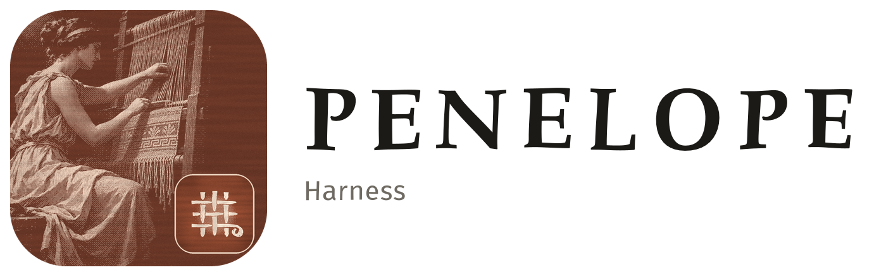

# Penelope brand

The mark of the harness is a woven square with one loose thread, painted in cream on terracotta `#C4623E`. Penelope wove
the shroud for Laertes by day and undid part of the work at night. The loose thread stands for that: the memory map can
take notes back.

This folder holds only what the repository needs: the lockup for the README and the four SVG files the terminal
pictures are built from. The full set of marks is kept outside this repository.

| File | Use |
|---|---|
| `lockup.png` | weave picture, name and the word Harness, used at the top of the README |
| `term-weave.svg`, `term-thread.svg` | the weave without its loose thread, and the thread alone as a mask |
| `term-mark.svg`, `term-word.svg` | the mark and the name for the start screen |

## In the terminal

The start screen sends `cli/art/penelope_360.png` through the graphics protocol of kitty. The name stays as text below
it; terminals without the protocol show the name alone. The SVG files in this folder remain the originals for the
README and the documentation. The old half-block bitmaps are gone.

| Picture | Size in pixels | Where |
|---|---|---|
| `weave_22x22.rgb` | 22 by 22 | side panel |
| `thread_22x22.gray` | 22 by 22 | mask of the loose thread, coloured by the mood |
| `penelope_360.png` | 360 by 360 | the painted picture on the start screen, through the kitty graphics protocol |

Colours of the interface: ink `#15131C`, night `#1E1B28`, raised `#2B2739`, paper `#F6F3EC`, clay `#E8825A`,
sea `#5FB3E4`, ash `#B5B1C2`, dim `#7C778C`, red `#FF6B6B`. Clay is the terracotta of the mark, made lighter for dark grounds.

| Mood | Thread colour | Face as text |
|---|---|---|
| awake | clay | `[#|#]` |
| thinking, working | sea | `[#~#]`, `[#>#]` |
| asking | red | `[#?#]` |
| learned | paper | `[#+#]` |
| asleep | dim | `[#.#]` |
