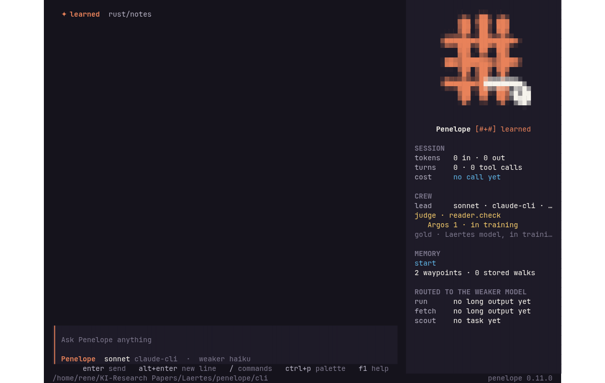
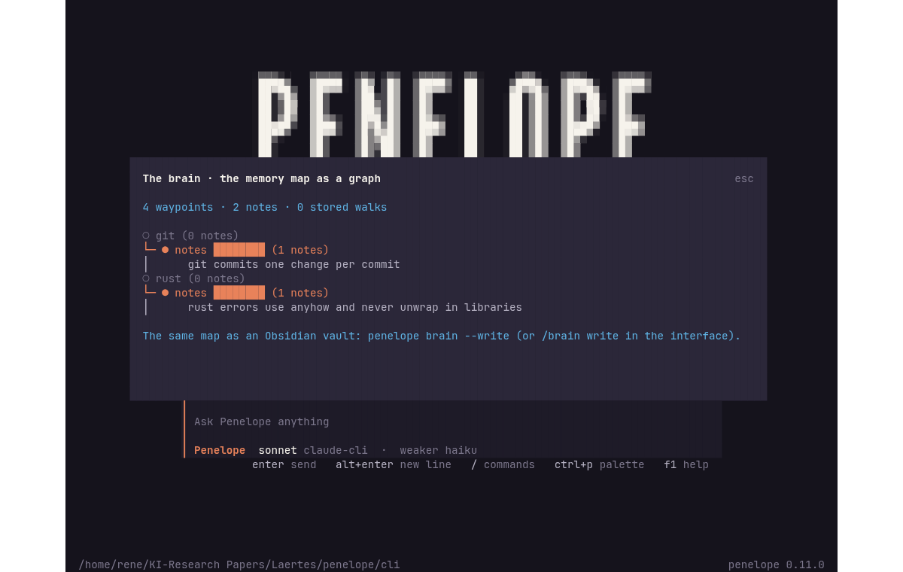

# Penelope 0.11.0 — Devlog

**Date:** 2026-11-25  
**Version:** 0.11.0, from 0.10.0  
**Scope:** one contract layer for every tool, models in every role, agents written with `$`, shared memory and an
Obsidian brain, cost in euro, ScreenCodec and Penelope's own cursor, plugin install and import, a startup weave, and
the commands and views that make these reachable.  
**Tests:** 189 passed, 0 failed. No test needs a key. The live runs against OpenCode Go are written down below and used no test fixture.

## DeepSeek phase 1 (branch `feat/phase1-worktree-evidence`)

### 1.1 One git worktree per cluster

A profile now carries `worktree`. It defaults to true when the profile has a worker part; the built-in `research` and
`live-test` profiles set it to false explicitly. `new_cluster()` creates a worktree and a branch `agent/<cluster id>`
under `<project>/.penelope/worktrees/` and stores `project`, `worktree`, `branch` and `cwd` in the cluster JSON. A
worktree profile in a folder without git is refused before anything runs, so a coding part cannot fall back to the
live tree.

API parts get the cluster cwd injected into every tool call that takes a `cwd` and did not name one. The Claude CLI
part starts with `current_dir` set to the worktree. `run_cluster()` applies the worktree patch with `git apply` only
after the validator answered PASS; a rejected patch is reported as a merge conflict, the cluster ends `blocked`, and
the worktree stays. `kill()` removes the worktree and its branch; a running cluster repeats the cleanup when it sees
the kill flag.

Measured: `cd cli && cargo test` → `168 passed; 0 failed` (2026-11-25). The new tests cover two clusters that edit
`hello.txt` in separate worktrees with one killed, a tool call without `cwd` that writes in its worktree, and a
worktree profile refused in a non-git folder.

### 1.2 Evidence field `V:`

`clusters::report` now builds every line with `proof::render`, so the fields S, P, T, F, E keep their order and their
escape rules, and `V:` is added when the cluster has evidence. `validate()` records every tool call of the validator
(API tool loops directly; Claude CLI parts through the `PENELOPE_TOOL_LOG` written by `mcp::call_raw`) and fills `V:`
with the first successful command check, for example `cat hello.txt ok`. A command counts as passed only with
`exit code 0`; a refused or failed check is written as `failed`.

A PASS counts only when at least one check ran and passed. A validator that said PASS without a tool call makes the
cluster `failed`; `run_cluster` also calls `proof::accept` before it writes `S:done`, so a done line without a
non-empty V cannot leave the cluster. The validator prompt now requires at least one check.

Measured: `cd cli && cargo test` → `172 passed; 0 failed` (2026-11-25). New tests: the solo fixture ends with
`S:done` and `V:cat hello.txt ok`; a PASS without a check ends `failed`; `proof::accept` rejects a written done line
without V; a Claude tool log becomes `cargo test ok` and `cat missing.txt failed`.

Open: a live Claude validator was not run in this session (no Claude login in the test environment). The tool-log
path is covered by a unit test of `checks_from_log`, not by a real `claude` call.

## DeepSeek phase 4.1 (branch `feat/plugin-install-check`)

### A local check before a plugin is registered

`plugins::check(dir)` reads only files that can execute: `.sh`, `.bash`, `.py`, `.js`, `.ts`, `.mjs`, `.cjs`,
`Makefile`, `Dockerfile`, `package.json` and extensionless install scripts such as `install`, `preinstall`,
`postinstall`, `setup` and `configure`. Prose is never read, so a `SKILL.md` or `README.md` that mentions
`curl ... | sh` does not refuse the plugin.

The patterns cover a download piped into an interpreter (`curl ... | sh`, `wget ... | bash`), `base64 -d ... | sh`,
`eval $(curl ...)` and process substitution, `rm -rf /` (including `/*` and `--no-preserve-root`), reverse shells
(`/dev/tcp/`, `/dev/udp/`, `nc/ncat/netcat -e|--exec`) and `package.json` hooks (`preinstall`, `install`,
`postinstall`, `prepare`) that download and run code. The first match is reported with the pattern, the file and the
line.

The work is bounded: 512 KB per file, 2,000 files and 16 MB in total, eight folders deep. `.git`, `node_modules`,
`target`, `dist` and symbolic links are skipped; binary files (a NUL byte in the first 4 KB) and files over the size
cap are counted as skipped, not read.

The check runs in `add`, local `install`, ZIP install (after unpacking, before registration; a refused ZIP folder is
removed again), git clone and pull (a refused fresh clone is removed; a pulled folder stays on disk), and every
plugin source of a marketplace. A clean report ends with `check: N script files checked, no suspicious pattern`. A
refusal starts with `NOT registered.` or `NOT installed.` and names the pattern and `file:line`; the registry is not
written.

`plugins::summarize` can add one sentence from the weaker model, but only with `PENELOPE_PLUGIN_CHECK_SUMMARY=1` and
only when the weak setting names a reachable model. A failed model call never changes the decision, and the check
itself makes no model call.

Measured: `cd cli && cargo test` → `190 passed; 0 failed` (2026-11-25). New tests: a `curl ... | sh` script is refused
with `install.sh:3` and stays out of the registry; a clean plugin installs and reports two checked scripts; a
`SKILL.md`, `README.md` and `docs/install.md` with the same text are not read; a 513 KB script and a binary `.js` are
skipped; every required pattern is recognized and five safe lines are not; a `package.json` postinstall is refused at
line 4; a ZIP, a marketplace and a git clone with a bad script are refused, and the clean marketplace plugin still
registers.

Manual: `penelope plugin add /tmp/.../bad` printed
`NOT registered. The local install check found a download piped into a shell (curl|sh, wget|bash) at .../setup.sh:3`,
and a clean plugin printed `check: 1 script file checked, no suspicious pattern`.

Open: the check is a heuristic, not a sandbox. The language linters of the plan and a confirmation after the report
are not built here. Patterns are line-based and can miss a command split across lines or obfuscated code; large and
binary scripts are skipped rather than inspected. An `update` that finds a problem does not remove the old registry
entry; it only refuses to re-register. The weak-model summary is off by default.

### 1.3 Stop a running model call, hard budget

`run_cluster()` now starts a watcher on the cluster's `kill` file and keeps an `Arc<AtomicBool>` in a process-wide
slot. The flag reaches `llm::run_loop` through the new `run_loop_with`; `chat_cancel` sends the HTTP request from a
worker thread and returns as soon as the flag is set, so a kill ends a part that is still waiting for the provider.
`cluster kill ID` also sets the flag directly when the cluster runs in the same process. A Claude CLI part is started
as a child and kept in a process slot; on cancel the child and its descendants are killed, not only the parent.

The budget is checked after every model answer with the usage of the loop that is still running. `budget_eur` on the
profile is joined by `session_budget_eur` in `config.json`; the orchestration takes one euro baseline and every cluster
of the session shares it. A crossing returns `BUDGET: ...`, the cluster ends `blocked`, and no worktree patch is
applied. A model without a price cannot be stopped in euro and is not guessed.

Measured: `cd cli && cargo test` → `184 passed; 0 failed` (2026-11-25). New tests: a fake server sleeps five seconds,
`cluster kill` returns the run in under two seconds after the kill, state `killed`; a reply with one million input and
output tokens against a 0.01 EUR cluster budget blocks after one request and leaves `hello.txt` at `base`; the same
crossing against `session_budget_eur` blocks a cluster that has no budget of its own.

Open: an abandoned HTTP request keeps its socket until the provider's timeout; the part is over, but the provider may
still bill the answer. The Claude kill path has no live Claude login in this environment and is covered by unit
structure only, not by a real `claude` child.

### 1.4 Zombie watch, dump and respawn

A profile now has `report_every` (seconds, `0` turns the periodic report off) and `stuck_after` (default 3). A
`ZombieThread` writes one report per interval while a part runs and feeds the `P:`/`F:` pair to the watch; three
equal pairs mark the cluster stuck. Every part also writes its tool calls to `calls.jsonl`, and `stuck_after` equal
calls in a row are a second, independent cause. A stuck cluster sets its cancel flag, removes its worktree, writes
`dump.txt` and `dump.json` with the cause, and ends `S:stuck`; no patch is merged.

`cluster_dump` prints the stored dump. `cluster_respawn` refuses without a dump cause, kills first, then creates a new
cluster with the old task plus `Cause from the dump: ...`, and records `respawns` (limit 2) and `respawned_from`.
`cluster_profile` writes or merges a profile file and parses it with the same `parse_profile` as a profile read from
disk. `orchestrate` respawns a zombie automatically, at most twice, before it marks the plan step done. The CLI has
`cluster dump`, `cluster respawn ID [EXTRA]` and `cluster profile NAME [JSON]`; the three tools are in `spec.rs` and
`mcp.rs`.

Measured: `cd cli && cargo test` → `188 passed; 0 failed` (2026-11-25). New tests: a cluster whose model sleeps five
seconds writes three one-second reports, is dumped and respawned, and the second model prompt contains the exact
`Cause:` line of the dump; three equal tool calls are a zombie cause; a respawn without a dump is refused and a third
respawn is refused; a profile written by the tool keeps `report_every: "2m"` as 120 seconds and `"4 reports"` as 4.

Open: the zombie watch is a heuristic. A part that needs longer than `stuck_after × report_every` without a finished
part is killed even if it is working; profiles that use long parts must raise `report_every` or `stuck_after`.

### 1.5 Parts of one cluster in parallel

A profile has `max_parallel` (default 1, clamped to 8). A part may name `needs: [other-part]`; a part without a
dependency starts at once, and a dependent part waits until every named part finished. Unknown names and cycles are
refused by `parse_profile`, so a broken plan never starts. `run_workers` runs a ready wave of up to `max_parallel`
parts in threads and joins them; only the main thread applies results, writes `memory.md` (also behind
`MEMORY_LOCK`) and writes the cluster JSON. The validator runs after the last worker wave. The cancel flag, the euro
limits and the zombie watch are shared with every thread; a kill cancels all running parts, and each Claude child has
its own process slot under `cluster id/part name`.

Measured: `cd cli && cargo test` → `190 passed; 0 failed` (2026-11-25). New test: three parts against a fake server
that sleeps one second per answer, with `max_parallel=3`, finish clearly faster than the same three parts at
`max_parallel=1` (roughly 1 s against 3 s plus the validator), and the memory file holds all three sections. A second
test parses `needs`, refuses an unknown part and refuses a cycle.

Open: a wave is filled before it starts and not refilled while it runs, so one slow part can leave a slot idle until
the wave ends. Parallel parts see the memory as it was before the wave, not the sections written by their neighbours.

### 1.6 Subclusters while running, with limits

A cluster part now has the tool `cluster_spawn(profile, task, name?)` (worker and lead; a scout and a judge cannot
spawn). The tool resolves the part's own cluster from a thread-local slot, or from `PENELOPE_CLUSTER` in the MCP
server of a Claude CLI part, so a child started from a running part is a real cluster with a parent. Only a part
inside a running cluster may spawn; outside a cluster the tool refuses and names `cluster_start`.

The root profile owns the limits of the whole tree. `spawn_create` walks the `parent` chain to the root, refuses when
`parent.depth + 1 > max_depth` (for example `depth 3 of 3`), and counts the parts of every cluster in the tree
against the root `max_models`; a refused spawn creates nothing on disk. The check and the child creation run under
`SPAWN_LOCK`, so two parallel parts cannot pass the same limit together. A child stores `parent`, `depth` and its
profile; after it runs, its report line is appended to the parent's `memory.md` and `children.jsonl`, and a `CHILD`
line goes into the parent's `reports.jsonl`. The orchestrator sees the tree through `cluster list`/`cluster_status`.

Measured: `cd cli && cargo test` → `208 passed; 0 failed` (2026-11-25). New tests: a part at depth 3 of 3 gets
`NOT spawned ... max_depth 3` and no child file; a part at depth 1 spawns a child at depth 2 that runs to `done`,
with the child id and `report: S:done` in the parent memory and `children.jsonl`; a tree with `max_models: 3` allows
two one-part children at 2 of 3 and 3 of 3 and refuses the fourth part with `max_models ... 3 of 3`.

Open: the child runs inside the tool call, so the parent part waits for it (no background queue and no refill of the
parent's slot). A writing child gets its own worktree from the live project, not from the parent's worktree; a child
patch can therefore conflict with the parent patch when both touch the same file, and the existing merge-conflict
path reports it rather than resolving it. The child does not inherit the parent's euro baseline; it enforces the
session budget from its own start.

### 1.7 A link between two clusters

A cluster part now has `cluster_ask(target, question)` (worker, lead and judge; a scout cannot ask). `target` is an
exact cluster id or a name; an unknown target is refused with the known ids. The asking part's cluster is resolved
from the same thread-local slot as `cluster_spawn`. The question is appended to the target's `memory.md` under
`## question from ASKER`, and the answer is appended to the asker's `memory.md` under `## answer from TARGET`.

The answer is read without any model call: the target's `output` first, otherwise the part sections of its
`memory.md`, otherwise its state. A finished target with neither output nor a part section is an error
(`is done but has no answer`), not a silent empty answer. The answer names its source (`output`, `memory` or
`state`), and a running target with no result yet is answered as a state line. Every exchange adds one `ASK` line to
`reports.jsonl` of both clusters and a full block to the asker's `ask.txt`; `cluster_status` shows the last links
under `Links:`, so the orchestrator sees the question and the answer without reading both memory files by hand.

Measured: `cd cli && cargo test` → `213 passed; 0 failed` (2026-11-26). New tests: a question appears in the target
memory and the answer in the asker memory, with an `ASK` line in the report stream and no model request; a running
target answers from a memory section and names `memory`; an unknown target and a done target with no part result are
refused with a clear message; a worker part calls `cluster_ask` through the real tool gate and its next model request
contains the target's `Option A is the design`.

Open: `cluster_ask` never waits for or starts the target, so a running target returns the state line until it has
written a part section; a long target output is capped at 6,000 characters. Two clusters with the same name resolve to
the newest one; an id is the unambiguous choice. The question and answer are in both memory files, but only the
asker's memory carries the answer, so a later target read does not see what it answered.

This is a working increment, not a claim that every limit is gone. The last section names what is still open and how
each claim can be checked on this machine.

## Why this version exists

The request had one sentence that decided the architecture: *no interface in tool routing may be corrupted in any
way*. Until 0.10.0 the tool list lived in `mcp.rs`, the dispatch lived in a `match` in the same file, and the tools a
scout could call lived in `scout.rs`. Three lists, three chances to disagree. Adding a tool meant editing all three
and hoping. A model could call a name that was listed but had no handler, or pass an argument with the wrong type and
learn about it from a shell error.

0.11.0 turns that around. `spec.rs` is one table: name, description and JSON schema of every tool. `route.rs` is one
gate: the role must hold the tool, then every argument is checked against the schema, then the handler runs. The MCP
server, the HTTP tool loops, the forged tools and the command line all pass through that gate. The tests prove the
table and the handlers agree, that every schema is well formed, and that a bad argument names the exact field.

The rest of the request follows from the same idea. A model in a role is a model behind the same gate. A privacy
model is one more stage with a strict JSON contract and a safe fallback. An agent is a plan of role calls. A tool
Penelope writes for herself is a row that joins the same table at runtime.

## The contract layer

### One table

`cli/src/spec.rs` holds 46 built-in tools as `(name, description, schema)`. The schema is JSON text, parsed when the
list is built. The file's test checks:

- every name is unique, lower case, and has a description;
- every schema parses, has `"type": "object"`, and every required field is declared with a type;
- every property has a type or an enum;
- the list a model sees has the same length as the table.

`mcp.rs` no longer writes its own list. `tool_specs()` returns `spec::list()`. `tool_specs_for(ctx, role)` filters it
by the role and appends the tools Penelope wrote for this project.

### One gate

`cli/src/route.rs` holds the eight roles:

| Role | Job | Tools |
|---|---|---|
| `lead` | talks to the person, plans, decides | all |
| `scout` | looks things up, changes nothing | 12 read-only tools |
| `worker` | makes one change | read, write, edit, run, jobs, search |
| `judge` | checks a claim against evidence | read, grep, tree, outline, run |
| `tool` | drives ScreenCodec, the cursor and plugin MCP tools | 7 computer tools, no write |
| `condenser` | shortens long output | none, it only answers text |
| `filter` | masks secrets before another model reads them | none |
| `router` | picks the plan and the roles | none |

`route::dispatch` does three things in order:

1. If the role does not hold the tool, it returns `NOT called. A scout has no tool write. Its tools: ...`.
2. If an argument has the wrong type, a required one is missing, an enum value is unknown or a nested item is wrong,
   it returns `NOT called. tool read: argument path must be string, got integer`.
3. Only then does `mcp::call_raw` run the handler. An unknown name can still be a forged tool; otherwise the refusal
   names the table.

The test `every_name_in_the_table_reaches_a_handler` calls every name with an empty object. It may fail on a missing
argument, but it may never say the tool is unknown. That is the regression guard against the three-lists problem.

### Tools Penelope writes herself

`cli/src/forge.rs` stores a tool as `.penelope/tools/NAME.json`:

```json
{
  "name": "rg_todo",
  "description": "Find TODO lines in the project",
  "schema": {"type": "object", "properties": {"dir": {"type": "string"}}, "required": ["dir"]},
  "command": "rg -n TODO {dir}",
  "origin": "penelope"
}
```

The model writes it with the tool `tool_new`, usually after `memory_go` read the notes where the idea was kept. The
interface reaches the same code with `/forge TOPIC`: it reads the waypoint and asks the lead to write the tool.

A created tool is checked before it exists:

- the name is 2 to 32 lower case characters, digits, `_` or `-`, and not a built-in name;
- the description is one line of 10 to 400 characters;
- every `{argument}` in the command is a declared, scalar argument;
- at least one argument is used, otherwise `run` is the right tool.

A call replaces each placeholder with one **single-quoted shell word**, so `a; touch pwned` stays one argument. The
rendered command then goes through `tools::run`, which means the same safe list, the same question to the person, the
same privacy filter and the same condensing as any other command. The test creates a tool, passes a value with `;` and
proves that no second file appears.

The forged tools are offered to the lead and the worker, never to a scout or a judge. The claude command gets their
names on its allow list too, so the same contract holds in both backends.

## Models in every role

`penelope provider use NAME --role ROLE` now accepts `main`, `weak`, `scout` and every role from `route::ROLES`:

```bash
penelope provider use anthropic --role router --model claude-haiku-5-5
penelope provider use ollama --role filter --model qwen3:8b
penelope provider use groq --role judge --model llama-3.3-70b-versatile
```

`config.json` gets `"roles": {"router": {...}, "filter": {...}}`. A role without a model runs on fixed rules and says
so. `penelope route` and `/route` show the table. The side panel shows Tiresias (router), Utis (filter) and Argos
(judge) next to the lead and the condenser.

### The privacy model between the models

`roles.filter` is the switch the request asked for. When it names a model, `tools::guard_count` runs after the fixed
rules and before any other model reads the text. The filter model gets a strict instruction and must answer one JSON
object:

```json
{"text": "Hallo [masked:name], wohnhaft in der [masked:street].", "masked": 2}
```

The answer is accepted only when:

- `text` is a string and `masked` is a number from 0 to 1000;
- the text is not longer than the input plus 10 % and 50 characters (a redaction does not add prose);
- a text cut in half with `masked: 0` is refused.

A broken answer changes nothing. The fixed rules stay the floor, one line goes to `stats.json` under
`privacy_model.failures`, and the turn goes on. This is the difference between a safety net and a single point of
failure. The test plays both cases against a stand-in server: a good answer masks two items, a prose answer is
ignored and counted.

### The router model chooses the plan

`roles.router` is optional. When it is set, `agents::routed_plan` asks it for a plan with a second strict contract:

```json
{"tasks": [{"role": "lead", "text": "inspect the repo"}, {"role": "worker", "text": "build the page"},
           {"role": "lead", "text": "report the result"}]}
```

The plan is refused and replaced by the fixed plan when a role is unknown, a task is empty, there are fewer than two
or more than `max_steps` tasks, the first or last task is not the lead, or more than `max_sub_agents` tasks are worker
or judge. The report says which plan ran: `router chose the plan` or `router failed (...); fixed plan`. A router can
therefore make routing better, but it cannot break the limits the person set.

## Agents written with `$`

`cli/src/agents.rs` parses the form from the request:

```text
$claude(role=orchestrator,thinking=max,goal="Baue mir eine komplette Website",max_sub_agents=3)
```

Supported settings:

| Setting | Values | Default |
|---|---|---|
| `role` | `orchestrator`, `lead`, `worker`, `judge` | `orchestrator` |
| `thinking` | `max`, `high`, `medium`, `low` | `high` |
| `goal` | 3 to 2000 characters, quoted | required |
| `max_sub_agents` | 1 to 8 | 3 |
| `max_parallel` | 1 to 4 | 2 |
| `max_steps` | 2 to 30, rounds per task | 12 |
| `budget_eur` | 0 to 100, 0 means no limit | 0 |
| `model` | overrides the lead model for this run | empty |
| `verify` | true or false, adds the judge | true |
| `language` | text | `en` |

The parser accepts single or double quotes and `\n` escapes. It refuses an unknown setting with the exact name and
the list of valid ones. It refuses a number outside its range with the range and the value.

The agent's name and settings are stored in `.penelope/agents.json`; **the goal is not stored**, because a goal may
hold private text. `penelope agents` and `/agents` list the settings. A run is started by writing the call again, by
`/orchestrate GOAL`, or by `penelope orchestrate '...'`.

### How a run works

The fixed plan is small and readable:

1. lead — inspect the project and write the shortest plan, naming the check that will prove the result;
2. worker — do the work, run the check, copy the evidence;
3. judge — PASS or FAIL with one reason, when `verify` is true and there is room;
4. lead — report what was done, what passed and what is still open.

`max_sub_agents` limits steps 2 and 3; `max_steps` truncates the middle but never removes the final report. Each step
is a real model call under the role of the step, with the tools of that role and through the same gate. A step sees
the short reports of the earlier steps, not their whole transcripts, so the context stays small. After every step the
new euro cost is compared with `budget_eur`; a used-up budget stops the run. A cancel flag stops it before the next
step and inside an HTTP tool loop.

`max_parallel` is stored and shown, but steps run in order. A worker may change a file that the judge then reads;
running them at once would make the evidence depend on the clock. The report says the limit instead of pretending it
was used. Parallel scouts already exist as the `scouts` tool, where the tasks are independent by definition.

The run writes `.penelope/agents/runs/ID.json` with the plan and each result, and prints:
how many steps ran, the tokens in and out, and the euro of this run.



The crew panel reads `.penelope/crew/`, one small file per member. It can therefore show a step that is running while
the transcript is still quiet, and two scouts that finish together cannot overwrite each other.

## Clusters: parts, one memory file, a validator

The agent layer is still there, but the architecture now has a larger unit: an orchestrator starts clusters. A cluster
is not a subagent. It is a group of parts with one job, built from a profile. A profile names its workers, an optional
validator, the role and slot of each part, and the model: `main`, `weak`, `scout`, `judge`, `worker`, a role name, or a
full model setting such as an OpenCode model. A part can therefore be Telemach, Argos, a Claude model, or a small local
model, and parts that are not needed are simply left out of the list.

The built-in profiles are `coding` (backend and frontend workers + Argos validator), `backend`, `frontend`, `live-test`
(tester + ScreenCodec tool part), `research` (two scouts) and `solo`. A user profile under
`.penelope/clusters/profiles/NAME.json` replaces a built-in of the same name. `max_models`, `max_depth`, `max_steps`,
`retries` and `budget_eur` are checked before a cluster starts; a part that names a Laertes family in training blocks
its cluster instead of being silently replaced.

The orchestrator asks the router model for a plan of one to four clusters and falls back to one `coding` cluster. A plan
may name `after` dependencies and a `parent`; independent clusters run in threads, a live-test cluster waits for the
coding clusters, and a subcluster waits for its parent. Every cluster writes one `memory.md`; every part appends to it.
The validator reads that memory, checks the project where it can, and answers `PASS` or `FAIL`. A FAIL sends the result
back to the workers for up to `retries` rounds. The report is the compact line from the architecture note:
`S:done|P:2/2|T:12s|F:end|E:-`.

Tools `cluster_start`, `cluster_status` and `cluster_kill` and the commands `/cluster GOAL`, `/clusters` and
`penelope cluster run/list/status/dump/profiles/kill` are the entry points. A live run with the real Claude command used
the `solo` profile: the worker created `hello.txt`, ran `cat`, the haiku validator checked the output and returned PASS,
and the cluster closed `done`. Five cluster tests run without a real provider.

## A small main context

Two mechanisms keep the lead's context small:

- **`@` context.** `context::expand` finds `@path` and `@memory:topic`, replaces the token with a short marker and
  appends one block. A file up to 80 lines and 4 KB arrives whole; a longer file arrives as its outline and its first
  25 lines with a path to `read`. A folder arrives as a one-level tree. At most 5 references and 6000 characters.
  A missing path becomes `[no file @...]` and a note, so the model knows the context is not there. The command
  `/context TEXT` shows the exact block before a model sees it.
- **Memory names, not text.** The system prompt gets the names of at most 14 waypoints and the count of notes. The
  note text comes only from `memory_go` or from the recall on the way to the waypoint for the request.

The test proves that a 200-line file does not send line 150 and that an e-mail address is not mistaken for a context
token.

## Memory for every session, and the brain

### Project memory and shared memory

`.penelope/memory/` stays the map of one project. `~/.penelope/global-memory/` (or `global_memory` in the settings)
is the map every session on this PC reads. `memory_note` takes `scope`:

- `project` — a fact of this repository;
- `global` — a rule that binds every later session;
- `auto` — a lasting rule goes to the shared map, everything else to the project.

`auto` uses `memory::scope_for`: words such as *always*, *never*, *from now on*, *prefer*, *immer*, *ab jetzt*,
*bevorzuge* mark a rule. A shared note is shown with `(shared by every project)`, and `memory_forget` can take it back
from either map.

### The end of a session

`tools::consolidate` runs when a session ends (`/new`, leaving the interface, `penelope consolidate`). It does not
call a model, so it cannot fail on a key or a network. It keeps:

- the user's lasting rules, deduplicated against the shared map;
- a complaint as feedback under `rules/feedback`, because a complaint says what must not happen again. The marker
  list includes *falsch*, *wrong*, *again*, *immer noch*, *schon wieder*, *broken*, *kaputt*, *nicht so*,
  *warum hast du*.

Every consolidation also leaves one line `session: <first request>` in the project map. The global rules are read at
the start of every later turn, before the project notes, so a preference is never cut off by a long project note.

### The graph and the Obsidian vault

`/brain` and `penelope brain` draw the map as a tree with a circle per waypoint (full when it has notes), a bar for
the number of notes, and the first two notes under the top two levels. `w` in the view or `penelope brain --write`
writes `.penelope/brain/` as an Obsidian vault:

- `index.md` with the whole map as `[[links]]`;
- one file per waypoint, with YAML front matter (`penelope_waypoint`, `notes`), `Up:` and `Down:` wikilinks, and the
  notes below a heading.

Old files are removed before a write, so a renamed waypoint cannot leave a lying node. Obsidian's own graph view draws
the same map from the folder.



## Cost in euro

Every call that reports usage adds its tokens to `.penelope/usage.json` under `role|model`:

- the lead model, after a turn in either backend;
- the condenser, after `run` or `fetch`;
- the scout, after a lookup;
- the judge, after `check`;
- the router, after a plan;
- a worker, after an agent step;
- the filter, after a privacy pass.

`penelope cost` and `/cost` print one row per role and model with calls, tokens in, tokens out and euro. The price
table is in `config.json`: dollars per million tokens, first entry wins by the longest model-name match. `eur_per_usd`
turns dollars into euro. A model without a price is counted and marked `no price`; it is never guessed. The side panel
shows one line: `0.042 EUR · 12 calls · 2 unpriced`.

The numbers are an estimate for steering, not a bill. The provider's invoice is the truth.

## ScreenCodec, the browser and Penelope's own cursor

`cli/src/screen.rs` keeps one ScreenCodec process alive and speaks JSON-RPC with it: `initialize`, one
`notifications/initialized`, `tools/list`, then `tools/call` with a unique id. A reader thread owns stdout and sends
each answer to the waiting caller. A timeout drops the process, so the next call starts clean instead of writing into
a dead pipe. The page a model opened therefore stays open between calls.

The tool `screen` has a stable action set that maps onto the real tools of ScreenCodec 0.8.1:

| Action | What it does |
|---|---|
| `open` | open an http, https or about address with `url`, `task` and `level` |
| `snapshot` | `screen` as text, with `level`; a question is shown next to the text, not answered by the server |
| `click` | click the element `id` from the snapshot; `x` and `y` only move Penelope's cursor first |
| `type` | replace the text of field `id` with `text` |
| `select` | choose `option` in select field `id`; without an option it lists them |
| `key` | press `Tab`, `Escape`, `PageDown` and the other navigation keys |
| `scroll` | scroll by `dy` pixels |
| `zoom` | a detail of one region between x0, y0 and x1, y1 |
| `image` | read one picture file as text |
| `desktop` | the real screen as text, with `scope`, `find` or `code` |
| `desktop_click` | click an element of the latest desktop capture |
| `confirm` | run a click that waits for the user, with the code and summary |
| `call` | call one ScreenCodec tool by name with its own arguments |
| `tools` | list the tools the server actually sent |

The ids matter: the click check compares the element the model saw with the element that would receive the click. An
x/y pair never replaces the id. A name the server did not list is refused with the list it did send, which matters
because ScreenCodec may rename a tool.

`cli/src/cursor.rs` is Penelope's own pointer. It uses `cursor.command` with `{x}`, `{y}`, `{label}` when set, else
`xdotool` on X11 or `ydotool` on Wayland. `cursor` moves without a click; `screen click` moves first, then clicks. A
PC without such a program gets a refusal that names the setting, not a silent no-op.

The cargo test starts a fake ScreenCodec script, opens a page, takes a snapshot, clicks by id, lists the tools and checks
that an unknown tool is refused and that the log holds the handshake. On 2026-11-24 the real ScreenCodec 0.8.1 was
installed from `projects/screencodec-mcp` and exercised against a real browser and the real desktop; the evidence is in
the next section.

## Plugins: install and take over

- `/plugins install LINK` and `penelope plugin install LINK` clone a git link into `~/.penelope/plugins/NAME`
  (`plugin_home` in the settings), then register it. An existing clone is updated with `git pull --ff-only`.
- A folder path is registered as it is.
- `/plugins import` and `penelope plugin import` scan `~/.claude/plugins`, `~/.claude/skills`,
  `~/.config/opencode/skills`, `~/.config/opencode/plugin`, `~/.codex/skills`, `~/.cursor/skills`,
  `~/.agents/skills` and `~/.penelope/plugins` (`plugin_dirs` overrides the list). A folder counts when it has
  `.claude-plugin/plugin.json`, `SKILL.md`, `skills/` or `.mcp.json`.
- The TUI and the plain chat run the import **once**: a marker `.penelope/imported.json` keeps it to one pass per
  folder.
- A new plugin still starts with its MCP tools denied; `/plugins allow NAME` changes that.
- A plugin's `commands/*.md` files are registered too. The file name or the `name` in the front matter becomes the
  command, `description` and `argument-hint` are shown. `$ARGUMENTS` and `$1` to `$9` are replaced before the prompt is
  sent; without a placeholder the arguments are appended.
- `/plugins` opens a filterable screen: type to filter by plugin or command, `tab` switches all / with commands / with
  MCP servers, `enter` opens the command list, `A` allows or denies the tools, `U` updates, `X` twice removes. A command
  is inserted into the input line and runs as `/plugin:command ARGS`.
- `penelope plugin commands [NAME]` prints the command list; `penelope plugin command NAME ARGS` prints the expanded
  prompt for a script.

The tests build a fake Claude folder, import it once, prove the second call is empty, install a local folder, and
clone a local git repository through a `file://` link.

## MCP tools, more tools, and the real PC test

### The tools of a plugin, for an HTTP model

The claude command starts the MCP servers of a plugin itself. A model behind an HTTP endpoint did not see them, which
was a hole in the "one harness" promise. `cli/src/mcpclient.rs` closes it without a long-lived process:

- `mcp_servers` lists every server of a plugin, with its tools when `probe` is true (at most 8 servers);
- `mcp_call` starts one server, does the handshake, calls one tool, returns its text and stops it.

The allow rule is the same as the claude allow list: a plugin with `"allow": false` is refused by name. One process per
call is a deliberate limit: a server that needs state between calls (a browser, a database session) still belongs to
its own tool or the claude command. The test builds a fake plugin with one echo server, proves that a denied plugin is
refused, allows it, calls the tool and lists it.

### Eight more tools

| Tool | What it adds |
|---|---|
| `mcp_servers`, `mcp_call` | plugin MCP tools behind the allow gate |
| `session_search` | a word across the stored conversations, with session and date |
| `http_request` | one GET, POST, PUT, PATCH or DELETE for an API, with headers and body |
| `json_query` | one value of a JSON file by a dot path, or the keys of an object |
| `git_diff` | the working or staged diff, optionally of one path |
| `clipboard` | read or write the desktop clipboard, text through stdin |
| `agent` | hand a whole goal to a named subagent; a subagent cannot start another |

`agent` is the tool form of the `$` call. The lead can delegate without the user writing `$`; the crew panel shows the
names. `agents::depth` refuses a nested subagent, so a run is one tree and cannot fork without a bound.

### The real ScreenCodec test

ScreenCodec 0.8.1 was installed from `projects/screencodec-mcp` into a temporary venv. `screencodec-mcp doctor` passed
Chromium, Tesseract, OpenCV, a test page and a click check. Then Penelope drove it:

- **Open and snapshot in one process.** `penelope screen demo http://127.0.0.1:8765/` returned 122 lines of hardened
  SDL text from a real page in one Penelope process. The first `tool call screen` on a separate process started a new
  server and had no page, which is why the demo command exists.
- **A model clicked by element id.** The lead model (OpenCode Go, `mimo-v2.6-flash`) was asked to open a local test
  page, snapshot, click the button "Increase the counter" by its id and snapshot again. It took 34 s, 3 tool calls,
  24,814 tokens in and 270 out, and reported the counter going from 0 to 1. The click went through the real click
  check of ScreenCodec, not a coordinate guess.
- **The real desktop is text.** With `screencodec.desktop = "on"` for one test, `screen desktop` returned 837×668 of
  the active window as 44 text elements in 1.2 s, no screenshot stored. The setting was switched back to `off`
  immediately and the captured text was deleted. The content is private and is not part of this repository.
- **Penelope moved the real pointer.** `penelope cursor 100 100` moved the X11 pointer to `X=100 Y=100`, checked
  with `xdotool getmouselocation`. The tool now reads the pointer back and refuses to claim success when a
  `mousemove` exits 0 but moves nothing (a Wayland trap).

The ScreenCodec mapping follows the real tools, not a guess: `open` takes `url`, `task` and `level`; `click`, `type`
and `select` take the element `id` from the snapshot; `scroll` takes `dy`; `desktop` takes `scope`, `find` or `code`.
An x/y pair only moves Penelope's cursor; it never replaces the id the click check compares.

### A live model through the contract

Two runs against OpenCode Go, key only in the environment, nothing stored in `config.json`:

| Run | Result | Tokens |
|---|---|---|
| `ask "Use the tool run to execute echo penelope-live"` | 1 tool call, exact output, exit 0 | 7,032 in, 61 out |
| `orchestrate '$reader(role=judge, ...)'` | read the README with the `read` tool, answered in one sentence, crew name `reader.check` | 9,008 in, 105 out |

The provider entry `opencode` sends the `x-opencode-session` header that the endpoint requires. `provider use` writes
the list price of a known model into `prices` the first time; the live folder then reported 0.0072 EUR for five calls.
A model with no known price stays `no price`, never a guess.

### Auto-learning, three ways

- A rule of the user is filed by the weaker model after an answer (`learn`).
- A lesson from tool use is filed after a failed or long turn (`learn_tools`), with the failing call and the call that
  worked instead.
- A complaint is filed immediately at the end of the turn as feedback (`rules/feedback`) and read at the start of the
  next run. A complaint is not a fact, so it does not become a rule by itself.
- `memory::mark_used` counts every successful walk through a waypoint; the brain shows a hot waypoint as `×n`. The
  map therefore learns which paths lead to answers that worked, not only which notes exist. `/learn` shows the
  lessons and the feedback of the folder in one page.

## Login, modes and more providers

### Login

`penelope login` and `/login` give two paths:

- `claude` runs the official `claude auth login`; `penelope auth` reads `claude auth status` and prints the method and
  plan, never the e-mail or the token.
- every other provider asks for the API key with the echo off on Unix, stores it in the Secret Service through
  `secret-tool` when the desktop has one, else in `~/.penelope/auth.json` with mode 0600. `penelope logout NAME`
  removes it from both stores. `OPENAI_API_KEY` (or the provider variable) still wins for one shell.

The key is printed nowhere. `auth::has` reads the small index, so a status page does not ask the keyring 35 times.
The live test stored a dummy Groq key in the Secret Service, saw `groq stored` in `penelope auth`, logged out, and the
keyring lookup returned empty.

### Providers

The table grew from 25 to 35 entries. New: Perplexity, Cohere, DeepInfra, Nebius, Novita, Hyperbolic, Lambda,
SambaNova, Nous Research, GitHub Models, plus OpenCode Go and the Laertes placeholder. Every entry names its base
address, wire format, key variable and example model. `penelope auth` lists which one has a key, a stored login or
nothing.

### Modes

`penelope mode` and `/mode` write a preset instead of six separate settings:

| Mode | delegate | commands | file changes | privacy | judge |
|---|---|---|---|---|---|
| `auto` | scout | safe | ask | rules | on |
| `manual` | off | safe | ask | rules | on |
| `safe` | off | safe | refused | rules | on |
| `review` | scout | safe | ask | rules | always |
| `privacy` | off | safe | ask | pii | on |
| `power` | scout | all | all | rules | off |

`files::permit` refuses a change in `safe` before it asks, so the mode is not a hint but a gate. The side panel shows
the mode under SESSION.

### The tool role and `computer`

The eighth role is `tool` (Nostos). It has only `screen`, `cursor`, `mcp_servers`, `mcp_call`, `read`, `outline` and
`tree`; it cannot write. The lead hands a whole PC task to it with the tool `computer`:

```text
lead: computer(task="open http://127.0.0.1:8766 and report the counter")
tool model: screen open -> screen snapshot -> report "Counter: 0"
lead: one tool result, no page text in its context
```

The live run used `mimo-v2.6-flash` as the tool model and returned the counter in 25 s; the lead spent 10,929 tokens in
and 117 out for one tool call. The tool model's steps are in its own loop and never enter the lead's context.

### Skills Penelope writes

`skills.rs` adds a third kind of learning next to notes and lessons:

- `skill_new` lets a model write a skill on purpose;
- `from_trace` writes a playbook after a successful turn with 5 or more tool calls. It stores the tool names and the
  arguments that worked, never the output, and applies the privacy filter to the arguments first;
- local skills live under `.penelope/skills/NAME/SKILL.md`, use the Claude Code front matter, and appear in the system
  prompt and in `/skills`. They can be copied into Claude Code or another harness as they are.

Live test: a turn with five `run` calls wrote `call-tool-run-exactly` with clean Markdown, the five commands and no
command output. A later `penelope skills` listed it with its description.

### Auto-update, no server yet

`docs/AUTOUPDATE.md` is the server and release blueprint; `cli/src/update.rs` is the client. The manifest has version,
platform, URL, mandatory SHA-256, optional minisign signature and notes. Redirects are off. On Unix the old binary is
kept as `penelope.old`; Windows gets `penelope.new.exe` because a running `.exe` cannot be replaced. Without
`update.url` both commands say that no server exists, which is the current state. Tests cover SemVer, the SHA-256
vectors and the manifest refusal.

### Leaks, ports and retries

- **Redirects are off** in every HTTP client (`net::agent`): a 3xx is returned, not followed, so an `Authorization`
  header cannot travel to another host. A test starts a 302 server and checks that only one request arrives.
- **Output that leaves a tool is guarded**: ScreenCodec text, MCP tool text, memory notes, skill bodies, scout reports,
  condensed output, `check`, `agent`, `computer` and `json_query`. A command's output never reaches a model without the
  fixed rules; the privacy model sits behind them when `roles.filter` is set.
- **Skills and consolidation are guarded** before they write: a key in a tool argument is masked in a playbook, and a
  rule is masked before it enters the shared memory.
- **`penelope audit`** scans every text file under `.penelope` (except the auth file, whose mode it checks) and the model
  endpoints. It reports a path and a count, never a value. On the live folder: 20 files, 0 findings.
- **Penelope listens on no port.** The MCP server is stdin/stdout, jobs write files, ScreenCodec and plugin servers are
  child processes with a timeout, and a local model server is a client.
- **A failed tool call is retried** when it is read-only and the error looks transient (timeout, reset, 502/503/504,
  busy). The retry is synchronous: the model waits for the result. A write, a commit, a click, a type or a shell command
  is never repeated by the harness; the model sees the error and repairs the call. The MCP server uses the same
  `dispatch_retry`, so a call from Claude is retried too.
- **Tool results have a timeout** at the network and child-process layers: model HTTP 300 s, fetch 25 s, HTTP request
  30 s, ScreenCodec 120 s, plugin MCP 120 s.

### The visible cursor and the real desktop click

On Hyprland the native cursor is moved with `hl.dsp.cursor.move({x=...,y=...})`; `hyprctl cursorpos` showed
`400,300` and `1200,700` after two `penelope cursor` calls, so the pointer on the desktop really moved, not only an
XWayland shadow.

The machine has no ydotool. `penelope input install` compiles a 100-line `/dev/uinput` helper (the desktop user has an
ACL on that device), and `penelope input enable` points `SDL_MCP_INPUT_CMD` at it. The helper reads the native cursor
position from `hyprctl`, moves by relative events until it reaches the target, and clicks:

- the page counter went from 0 to 1 and then to 2 in two `screen desktop-click` runs;
- `screen desktop-click` captured the active window, found `Increase the counter`, called `desktop_click` by id and
  captured again;
- `screencodec.desktop` is back to `ask`, so a capture needs the local confirmation; `desktop_input` stays on only
  because `input enable` was run.

### Windows

`platform.rs` holds the differences: `cmd /C`, `taskkill /T /F`, `clip` and PowerShell `Get-Clipboard`, a PowerShell
`SetCursorPos` + `mouse_event` pointer path, `USERPROFILE`, `PATHEXT` in `which`, and Windows read-only commands in
the safe list. `jobs.rs` compiles without `std::os::unix` on Windows, and the updater writes `.new.exe`. No Windows
machine was available, so this is source-level work marked untested in the README.

## Web search and the scraper

### The engines

The old search tried one source and returned its list. The new one has ten sources:

| Source | Key | Notes |
|---|---|---|
| Server API | `PENELOPE_SEARCH_API_KEY` | `POST search.api_url`, strict JSON, first when set |
| DuckDuckGo | none | HTML page, lite fallback; rate limited after a few queries |
| Startpage | none | HTML results with direct links; the better keyless source |
| Bing | none | `b_algo` results; the `bing.com/ck/a` tracking link is decoded to the real URL |
| SearXNG | instance URL | JSON API, language and safe search |
| Brave | `BRAVE_API_KEY` | API, freshness and dates |
| Tavily | `TAVILY_API_KEY` | score, date, topic, `search_depth` |
| Exa | `EXA_API_KEY` | highlights, neural search |
| Firecrawl | `FIRECRAWL_API_KEY` | search and scrape shapes |
| Wikipedia | none | last resort when both HTML engines refuse |

`penelope login tavily` (and `exa`, `firecrawl`, `brave`, `search`, `rerank`, `reader`) stores a service key in the
Secret Service, the same store as a model key. `penelope auth` lists them under `search and reader keys`. The
environment variable wins.

`fanout` is on by default: every configured engine is asked in one thread each, then the hits are deduplicated,
scored and merged. Without a key or server that is Startpage + DuckDuckGo + Bing; a key or server adds a source above
them. It costs one call per engine. `/search fanout on|off` (or `penelope search fanout on|off`) switches it, and
`search health` names the engines and the current mode. A query is cached for an hour by default; `--fresh` skips it
and a new `web_search` call can pass `fresh: true`.

### The ranking

- canonical URL: fragment and `utm_*`, `ref`, `fbclid`, `gclid` dropped; trailing slash normalised;
- score = engine weight + query-word overlap + provider score; a second result from the same host loses 0.18;
- at most 8 results, each with engine, score and published date.

No hidden reranker. A person can see why a page came first, and a later model reranker is an open step in
[`NEXT.md`](NEXT.md).

### The scraper

`scrape.rs` is a self-contained HTML reader:

- title, description, author and date from meta tags and JSON-LD;
- `<article>`, `<main>`, `role="main"` or the body;
- scripts, styles, nav, footer, forms and dialogs removed;
- headings, paragraphs, lists, blockquotes, links, images, tables and fenced code;
- named and numeric entities decoded; cookie and sign-in lines dropped;
- redirects followed by the client up to four times, without an Authorization header;
- 5 MB per page, optional Jina Reader for a JavaScript page (off by default).

`fetch` now uses it: the lead gets a 10-line answer, the weak model reads the Markdown, and a page under 1,800
characters passes whole. The old regex that removed every tag is gone from the fetch path.

### Research

`research` (and `penelope research`) makes 1, 2 or 4 queries depending on `depth`, fetches the best pages in parallel,
and asks the weaker model for at most 15 lines with `[1]` citations. The answer, every source and the engines that
answered are returned. The lead never sees the pages.

Live: `penelope research "What is the tokio select macro and when should I use it?" --depth standard --pages 3` took
10.3 s, fetched three pages and returned a cited answer with ten sources; `search "rust tokio select!"` returned eight
results from DuckDuckGo in 0.7 s. After DuckDuckGo rate-limited this address, Bing answered and the tracking links were
decoded.

The full design, the key variables and the limits are in [`SEARCH.md`](SEARCH.md). The next steps — a rate-limit-proof
keyless fallback, prompt-injection scanning, worktrees, Windows/macOS builds — are in [`NEXT.md`](NEXT.md).

### No Claude server search

Claude's API offers a server-side `web_search` tool. Penelope **does not use it**: the index, the ranking, the page
fetch and the price would all sit behind one vendor, and the cache would be outside the project. The search stays
client-side: the query goes to engines the user chose, the ranker and the scraper are local, and the result can be
audited.

That leaves a real gap: DuckDuckGo, Bing and Startpage rate-limit automated clients. A self-hosted search API is the
next server-side piece; the requirements, the JSON shape and the other server APIs Penelope needs (reader, embeddings,
reranker, privacy, model families, update, registry, auth) are in [`SERVER-APIS.md`](SERVER-APIS.md).

### The server contracts, wired

The contracts are now clients, not only prose:

- **Server search.** `search.api_url` is called with one JSON body (`query`, `language`, `country`, `safe`,
  `recency`, `limit`, `page`) and an optional bearer key. The answer must hold `results[]` or `data[]` with a title
  and an `http(s)` URL; a broken answer is an engine error. `api` joins `auto` at the front when the URL is set.
- **Several SearXNG instances.** `search.urls` is a list; `search.url` is tried first, then each base until one
  answers with a result.
- **Health.** Every engine call appends to `.penelope/search/health.json`: calls, failures, last duration, last
  success and the last error (160 characters). `penelope search health` prints it; `--probe` sends one small query
  per engine. The file holds no query text.
- **Rerank.** `search.rerank` is `{enabled, url, api_key_env}`. The local ranker keeps 20 hits, one `POST` sends the
  query and the candidates, and only `{results:[{index, score}]}` is accepted. A timeout, a wrong shape or an empty
  answer returns the local order; unnamed hits keep a low place instead of disappearing.
- **Instruction warnings.** The scraper scans the page text for lines aimed at an agent and for zero-width or bidi
  characters. The page is still read; `fetch` and `research` show the warning with it. This is deterministic and
  honest, not a claim that a page is safe.

The new tests use the same stand-in server as the model tests: one search answer, one reranker answer, one broken
reranker answer, and a health file that must count a success and a failure. No new test needs a key.

Live: `penelope search "tokio select macro" --fresh` returned 8 hits from Startpage, DuckDuckGo and Bing in 0.4 s.
`penelope search health --probe` wrote one row per configured engine.

### PDFs and the reader API

`fetch` used to read a PDF as if it were HTML: the bytes became replacement characters and the model got noise. The
local path is now `pdftotext -layout`: a PDF is written to a temporary file, converted, and the temporary file is
removed. The title is the first non-empty line, the text passes the same instruction scan as a page, and a scanned PDF
with no text layer says so instead of pretending.

A PDF that `pdftotext` cannot read, or a page whose text hides behind JavaScript, can go to the P1 reader API:
`reader.url` with `{url, max_chars, formats:["markdown"], wait_ms}` and a strict answer. The client refuses a private,
loopback, link-local or unresolved target before the request, so a misconfigured server cannot be used as an SSRF
proxy. `doctor` now prints the search API, its counters and whether `pdftotext` is present.

Live: a generated PDF over local HTTP came back as 24 words of clean text, and the same file was unreadable before the
change. `pdftotext` is at `/usr/bin/pdftotext` on this PC.

### ZIP without a shell

The 42nd tool is `unzip`. It does not call `unzip(1)` blindly:

- the archive is read twice: once for a plan, once for the extraction;
- `enclosed_name` refuses an absolute path, `..` and a name outside the target;
- symbolic links are refused;
- more than 10,000 entries, a file over 50 MB or 200 MB unpacked are refused;
- the target must be new or empty and must stay below the working folder;
- the person sees the file list and the size before the first byte is written;
- `edit_policy` applies, so `safe` refuses it and `all` runs it without a question.

The same extractor backs `penelope plugin install archive.zip`. A plugin ZIP is unpacked into a hidden staging folder,
a single wrapping folder becomes the plugin folder, and the result is registered. A local ZIP, a `file://` ZIP and an
HTTP(S) ZIP are accepted; a download is capped at 50 MB. `plugin install` still takes a Git URL or a plain folder.

Live: a ZIP with `bundle/readme.txt` and `bundle/notes/today.txt` unpacked as two files; a ZIP entry `../escape.txt`
was refused before anything was written; a plugin ZIP with `.claude-plugin/plugin.json` and `SKILL.md` registered as
`zip.plugin` in the plugin home.

### The local server

`penelope serve` is the first real server, not another client contract:

| Endpoint | Answer |
|---|---|
| `GET /health` | version, uptime, sources, auth, limit, local PDF support |
| `POST /search` | the same ranked hits as the client, with `page` and `limit` |
| `POST /read` | HTML or PDF as Markdown, with warnings and links |
| `POST /embed` | 256 deterministic token/bigram vectors |
| `POST /rerank` | BM25 indices and normalised scores |
| `POST /redact` | fixed-rule masks with byte offsets |

The security is deliberately small: loopback by default, a bearer token from `PENELOPE_SERVER_TOKEN` for every POST
when set, `--allow-remote` plus the token for another bind, 120 requests per minute per address, a 2 MB body cap, a
20 s read timeout and a 30 s upstream timeout. The server clears `search.api_url`, `search.rerank` and `reader.url` in
its own settings, so a client configuration cannot make it call itself. `/read` refuses a private or unresolved target
before the request and checks every redirect again, so a public URL cannot bounce into the local network.

`/embed` and `/rerank` are model-free on purpose. The vectors are feature hashes, not a transformer; the ranker is
BM25, not a cross-encoder. They are useful today and honest about what they are. A real embedding model can replace
the vector endpoint behind the same shape later.

Live: the health endpoint named Startpage, DuckDuckGo and Bing; `/search` returned 8 hits; `/read` returned the Tokio
select page as Markdown; `/embed` returned 256 numbers; `/rerank` put the Rust document first with score 1.0; `/redact`
masked `hunter2` and `a@b.com`; `/read` refused `http://127.0.0.1`. The Penelope client then ran with
`search.kind: "api"` and the server as `api_url` and `rerank.url`, and printed 8 hits with engine `api`.
`GET /whoami` answers 401 without the token and `{"token_valid": true}` with it.

### Normal use, plugin and MCP management, verification

Normal use is not a claim with a screenshot only. The plain chat completed a turn with the claude command
(`Reply with exactly: ok` → `ok`, 22,840 tokens in, 4 out), `penelope ask` returned `ok`, search returned 8 live hits,
`fetch` read a page, `unzip` wrote two files, and the server answered the endpoints above. The TUI command tests cover
the handlers that a screen would press.

**Plugins** now have a full small lifecycle: `add DIR`, `install LINK|ZIP`, `import`, `list`, `allow`, `deny`,
`update NAME`, `remove NAME`. `update` pulls a git install with `--ff-only`, or re-reads a local/ZIP folder so a new
skill appears without adding the plugin again. `remove` takes the entry out of `plugins.json` and leaves the folder on
disk, so nothing is deleted by surprise. Live: adding a skill to a plugin and `plugin update` made it appear; `plugin
remove` left `plugins.json` empty and the folder intact.

**MCP** management no longer starts and ends at plugin servers. `penelope mcp add NAME COMMAND [ARGS...]` writes a
standalone server to `.penelope/mcp.json`; `remove`, `allow`, `deny`, `list --probe` and `call` work on it exactly like
a plugin server. The same allow gate applies: a new server is denied until `mcp allow NAME`, and a denied call changes
nothing. Live: an echo server was added, probed (`echo — echo one text`), called (`echo:hi`), and removed.

**Verification** is now a real request, not only a key count. `penelope auth verify [main|weak|scout]`:
- Claude uses `claude auth status`; the live answer was `main: ok — claude: signed in via claude.ai (max)`.
- An OpenAI-compatible provider asks `GET {base}/models` with its key and reports how many models the answer lists.
- An Anthropic provider asks `GET {base}/v1/models` with `x-api-key`.
- If a provider has no model list (HTTP 404/405), it falls back to one one-token ping to `chat/completions` or
  `/v1/messages`, so the model itself is verified and not only the key.
- A missing key, a refused key (`401`), a timeout and a Laertes family in training each get a `FAIL` line with the reason.
- The key is never printed; the test with the stand-in server asserts the secret is absent from the output.

The server token has its own check: `GET /whoami` returns 401 without the bearer token and the service identity with
it. That is the closest thing to a login page, and it is on purpose: the server has no HTML and no user database.

### Worktrees, daily probes and CI

`penelope work` is the safe half of the worker plan. `work new NAME` runs `git worktree add` under
`.penelope/worktrees/NAME` on branch `agent/NAME`; `diff` stages the worktree and prints one binary patch; `apply` pipes
that patch into `git apply` in the live tree; `remove --force` throws it away. A test creates a real repository, changes
a file in the worktree, sees the live file unchanged, applies, and checks the new content. What is still missing is the
model worker inside the worktree and the judge gate before `apply`.

Search now has a daily probe: `penelope search probe --daily` writes one health row per engine and a marker under
`.penelope/search/probe.json`; a second call the same day is a no-op. `penelope search instances add URL` appends a
SearXNG base to `search.urls` and writes `config.json`; `search instances` lists the pool. `deploy/` holds a systemd
timer for the probe.

The reader's scanner grew teeth: `scan_html` flags CSS-hidden blocks, the `hidden` attribute and `aria-hidden`; `scan`
adds fake `system:`/`assistant:` lines and instruction tokens. The page is still read, and the warning travels with it.

CI is now a matrix for Linux, Windows and macOS; Windows and macOS are marked experimental until a runner proves them.
`cargo audit` and the website's `pip-audit` run in the same workflows.

### The interface after the second pass

The start screen is typographic now: a spaced `P E N E L O P E`, a thin clay rule and the four state lines. The old
80×16 bitmap wordmark and the flat orange mark are gone; at terminal size they read as blocks. On a new session the
rule is woven from left to right for 1.5 s, then the screen settles. `PENELOPE_NO_ANIM=1` or a pipe skips it.

Keys: **F5** starts a new session and resets the animation. **F6** arms a delete; a second F6 within four seconds
removes the current transcript, its history and its tab. A first F6 only shows the warning.

The provider and model screens are separate now. `/providers` connects a provider, `/model` chooses the model:

- arrows choose a provider, `tab` switches main/weaker, `enter` signs in or opens the key window;
- a Claude provider runs the official `claude auth login` on the plain terminal and returns;
- an API provider opens a masked key window: the first four characters stay visible, the rest are bullets, `enter`
  stores and `esc` cancels;
- `r` opens the crew model list: tool calls, processing, research/web search, coding, judge, router and filter;
- `m` lists exact names (`claude-opus-5-5`, `claude-sonnet-5-5`, `claude-haiku-5-5`, the full OpenCode Go list);
- `e` cycles the model's effort. The levels come from the model, not from a global list: Claude 5 and 4.6+ take
  `low`, `medium`, `high`, `max`; OpenAI reasoning models take their list; DeepSeek rejects `medium` and uses
  `low`/`high`/`max`; Qwen, GLM, Kimi, Grok, Gemini and OpenRouter have their own columns; every OpenCode model shows
  the exact column of the catalog. A model without the field shows `no effort` and no parameter is sent. The check
  sits in `providers::supports_effort` and `llm::effort`, so the Claude command, the Anthropic messages API, the
  OpenAI body, the scout, the weaker model and every agent step use the same answer.

`/rules session TEXT` keeps a rule in the project; `/rules global TEXT` keeps it for every project. A tip appears in
the transcript every four turns and points at F5/F6, the role models, exact names and effort.

### Budget, checkpoints, sandbox, CI

- `/budget 20` sets `monthly_budget_eur`; the side panel and `/cost` show the month's spend and what is left.
- A checkpoint is written before every turn. `/rewind 3` restores the transcript and the file changes of the last three
  turns through the same undo records.
- `/sandbox on` runs `run` through bubblewrap: read-only root, the working folder writable, private `/tmp`, no network.
  It fails closed when `bwrap` is missing.
- A command confirmed in the approval dialog is stored as a hash with a masked preview in `.penelope/allowed.json`;
  the next identical command runs without a second question. `penelope allow` lists them, `penelope allow clear` empties
  the list.
- `penelope ask --json "..."` emits newline-delimited JSON events (`start`, `delta`, `text`, `tool_start`, `tool_end`,
  `masked_request`, `masked_answer`, `result`, `error`) for CI and editors.
- The `pr_create` tool opens a pull request with `gh` after a question. It never pushes.

### The model list comes from the provider

The exact-name picker used a static catalog. It now asks the provider: GET `/models` for an OpenAI-compatible address,
GET `/v1/models` with `x-api-key` and `anthropic-version` for Anthropic, with the same key rules as a chat request. The
answer is cached in `.penelope/models/<provider>.json`, shown at once on the next open, and refreshed in a background
thread while the picker is already usable. A provider that does not answer leaves the cache or the built-in catalog in
place and the screen says where the list came from.

The parser reads `data` and `models`, drops embeddings, speech and image models, and takes the label and the effort
column from the item when the provider sends one. OpenCode Go sends
`capabilities.reasoning.effort`, so `muse-spark-1.2-contributor` and `beam-free` appear from the live answer even
though they were not in the static catalog. The Claude command has no list endpoint; its three subscription aliases
stay built in. `penelope models [PROVIDER]` prints the same answer for a terminal or a script.

### Plugin commands and the command screen

The first plugin pass registered skills and MCP servers only. Commands in `commands/*.md` were invisible, so a plugin
that ships `/deploy` or `/review` could not be used. The registry now scans that folder, keeps name, description,
argument hint and file, and the command becomes `/plugin:command ARGS` in the interface. The same text is available to
scripts through `penelope plugin command`.

`/plugins` is a screen now, not a pager: a filter field, a sorted list (plugins with commands first, then MCP servers,
then the rest), a detail pane with path, commands, skills and servers, and actions on uppercase keys so lowercase
letters can filter. Enter on a command puts `/plugin:command ` into the input line; the person adds arguments and
presses enter. The live test used a demo plugin with `commands/echo.md`, typed `/plugins`, filtered with `echo`, opened
the command, inserted `/demo:echo `, typed `plugin-ok` and got `plugin-ok` back from the model.

### Phase 0: the three cluster modules and the flake check

The branch `feat/cluster-building-blocks` carried three unwired modules: `proof.rs` (a report line with an evidence
field `V:`), `notes.rs` (Markdown notes with links and `confirmed`/`open`/`stale`) and `advise.rs` (accepted and
rejected results per part and task type, with a suggestion after five results). They were cherry-picked onto the
cluster branch, the three `mod` lines stayed in `main.rs`, and the suite rose to 189 tests. Nothing calls the modules
yet; they are the base for Phase 1.2 and Phase 2.

The one unexplained 105/109 flake did not return: twenty complete `cargo test` runs in a row passed, 20 of 20. The
harness itself still has no nightly repetition job; this was a local loop.

### The interface bugs of the 0.12 pass

- A paste now goes to the open field. An API key pasted in the key window lands in the masked input (`sk-p•••`), not in
  the prompt; a unit test proves the prompt stays empty.
- The start screen shows the actual mark from `brand/term-mark.svg` again: 40 by 40 pixels, 40 columns and 20 rows above
  the `P E N E L O P E` wordmark. Terminals below 38 rows keep the text-only screen.
- Delete removes the selected session from the session list and its transcript/history. If it was the open session,
  the interface starts a fresh chat. The list says `entf deletes`.
- `/providers` and `/model` are separate screens now. `/providers` shows provider, kind, key state and key variable;
  `enter` connects. `/model` shows the provider's model list, the effort column, `tab` main/weak, `r` role models and
  `e` effort. `/models` only points at the two new commands.
- The plugins screen uses compact counts (`0c 1s 1m`), wider names and a footer that fits. The provider text list
  prints one block per provider, so long addresses and notes no longer wrap into broken columns.

## Startup animation

`cli/src/startup.rs` draws five frames: the loose thread grows `~`, `~~`, `~~~`, `~~~~`, and the name and model line
settle. It runs only on a terminal: a pipe, `--no-animation`, `PENELOPE_NO_ANIM=1` or `TERM=dumb` prints the last
frame once. The TUI home screen weaves the first ten blocks over 1.5 s while the interface already accepts keys; it
never blocks a turn.

## Commands and views added

| Command | What it does |
|---|---|
| `/model` | chooses the model of the current provider |
| `/btw TEXT` | keep a quick note without interrupting |
| `/rules [TEXT]` | show the shared rules, or add one to `rules` |
| `/orchestrate GOAL` | run an agent on a goal |
| `/agents` | the stored agents |
| `/forge TOPIC` | write a tool from the notes at a waypoint |
| `/brain [write]` | the graph, or the Obsidian vault |
| `/cost` | tokens and euro per role and model |
| `/context TEXT` | what `@` and the memory map would send |
| `/route` | roles, tools and models |
| `/tools` | the tool contracts |
| `/consolidate` | keep this session's lasting rules for every project |
| `/plugins install LINK`, `import`, `allow NAME`, `deny NAME` | plugin work |
| `/mcp [probe]`, `/mcp call SERVER TOOL JSON` | plugin MCP servers and their tools |
| `/screen tools`, `open URL`, `see`, `click ID`, `type ID TEXT`, `desktop`, `call TOOL JSON` | the computer through ScreenCodec |
| `/cursor X Y [click]` | Penelope's own pointer |
| `/export` | the session as Markdown under `.penelope/exports` |
| `/forget TEXT` | take back one note |
| `/price MODEL IN OUT` | a price for the euro report |
| `/auto` | switch auto-learning on or off |
| `/learn` | the lessons and the feedback of this folder |

One prompt may hold several commands: newlines or `;;` separate them, and the text after a command belongs to it to
the end of its line. For example:

```text
/scout web;;/note tests run with cargo test
/btw the API host is staging.internal;;/cost
```

The plain chat uses the same parser. `penelope ask` and the TUI expand `@` before the turn.

New CLI commands: `tools`, `tool list`, `tool call NAME JSON`, `route`, `agents`, `run-agent NAME --goal TEXT`,
`orchestrate`, `brain [--write]`, `cost`, `price MODEL IN OUT`, `consolidate`, `plugin install`, `plugin import`,
`screen tools`, `screen demo URL`, `screen ACTION JSON`, `cursor X Y [--click]`, `mcp list [--probe]`.

## Tests and evidence

`cargo test` in `cli/`: **189 passed, 0 failed**. The new tests, all without a real provider:

| Test | What it proves |
|---|---|
| `spec::every_tool_has_one_clean_contract` | 42 unique tools, parseable schemas, required fields declared |
| `spec::every_name_in_the_table_reaches_a_handler` | no listed tool without a handler |
| `route::a_bad_argument_names_the_field_and_the_type` | the gate refuses the exact field and type |
| `route::a_call_outside_the_role_never_reaches_the_tool` | a scout cannot write, a router has no tools |
| `forge::the_contract_refuses_a_broken_tool_before_it_exists` | the tool writer's checks |
| `forge::a_forged_tool_quotes_every_argument_and_runs_through_the_policy` | no shell break-out, the gate knows the tool |
| `privacy::a_privacy_model_can_stand_between_the_models_and_a_broken_answer_is_ignored` | strict JSON, fallback to rules |
| `agents::the_example_from_the_user_parses_into_a_spec` | the exact `$claude(...)` example |
| `agents::a_broken_call_names_the_exact_word` | every parser refusal |
| `agents::a_router_model_chooses_the_plan_and_a_broken_answer_falls_back` | router contract and fallback |
| `agents::settings_are_stored_without_the_goal` | the goal never reaches `agents.json` |
| `context::several_commands_and_a_turn_can_stand_in_one_prompt` | multi-command prompts |
| `context::at_paths_become_a_small_context_block` | outline instead of a long file, missing path note |
| `brain::the_graph_and_the_vault_show_the_same_waypoints` | ascii tree and Obsidian links |
| `tools::a_rule_of_the_session_reaches_the_shared_memory_once` | consolidation, dedupe, complaint feedback |
| `tools::a_commit_stages_names_files_and_never_pushes` | `git_commit` in a temp repo |
| `tools::the_judge_answers_pass_or_fail` | judge contract and usage row |
| `cost::tokens_become_euro_and_an_unknown_model_is_marked_not_guessed` | the euro formula and `no price` |
| `screen::a_fake_screencodec_keeps_its_page_across_calls_and_checks_tool_names` | handshake, actions, unknown tool |
| `plugins::a_known_folder_is_taken_over_once_and_a_folder_installs` | import once, local install |
| `plugins::a_git_link_is_cloned_into_the_plugin_home` | clone and update through `file://` |
| `cursor::a_command_receives_quoted_coordinates_and_a_label` | quoted cursor command |
| `tui::several_commands_in_one_prompt_run_in_order` | the interface uses the same parser |
| `tui::the_brain_opens_as_a_graph_and_the_context_preview_shows_the_block` | graph overlay and `@` preview |
| `tui::export_price_forget_and_learn_work` | export, price, forget and the learn page |
| `mcpclient::a_plugin_server_is_probed_and_called_only_after_allow` | plugin MCP probe, deny, allow, call |
| `tools::json_session_clipboard_and_http_tools` | JSON path, session search, clipboard, HTTP request |
| `tools::an_agent_refuses_a_laertes_family_in_training` | the agent tool, a gold family, crew state `in training`, depth back to 0 |
| `tools::a_computer_task_goes_to_the_tool_role` | the tool role sees screen/cursor and no write, the usage row is `tool` |
| `tools::only_a_transient_read_only_call_is_repeated` | retry only transient read-only calls, never a write or a click |
| `tools::a_transient_read_is_repeated_and_a_write_is_not` | the loop waits and delivers; a write is not repeated |
| `skills::a_long_successful_turn_becomes_a_skill_without_output` | a 5-call turn writes a clean Markdown skill and no tool output |
| `plugins::a_claude_marketplace_installs_its_plugins` | a marketplace file registers both plugins |
| `plugins::a_zip_plugin_is_unpacked_into_the_plugin_home_and_registered` | a ZIP with a wrapping folder becomes the plugin folder |
| `files::tests::unzip_writes_inside_the_workspace_and_refuses_an_escape` | two files unpack, `../outside` and a full target are refused |
| `files::tests::a_zip_entry_that_climbs_out_is_refused_before_anything_is_written` | zip-slip leaves no file outside the target |
| `server::health_and_models_are_readable_and_a_token_is_checked` | `/health`, 401 without the token, `/embed` with it |
| `server::embeddings_are_deterministic_and_normalized` | same text, same 256-vector, norm 1 |
| `server::rerank_puts_the_document_with_the_query_words_first` | BM25 order and `top_k` |
| `server::redact_masks_secrets_and_keeps_byte_offsets` | secret and email masks, exact offsets, `rules` versus `pii` |
| `server::the_reader_endpoint_refuses_a_private_address_without_a_request` | loopback, private and `file://` targets are refused |
| `server::search_and_rerank_refuse_an_empty_body` | missing query/documents and a GET on a POST endpoint |
| `auth::verify_names_the_provider_answer_and_never_prints_the_key` | a fake `/models` answer, `2 models`, no key in the line |
| `plugins::a_plugin_can_be_removed_and_rescanned` | update re-reads a changed skill, remove clears the registry |
| `mcpclient::a_standalone_server_is_added_allowed_called_and_removed` | `mcp add`, deny, allow, call, remove |
| `audit::a_key_in_a_file_and_a_plain_http_endpoint_are_found` | leaks are found, values are not printed |
| `net::a_redirect_is_not_followed` | a 3xx is not followed, so a key cannot move to another host |
| `input::the_helper_source_is_embedded` | the native pointer source is in the binary |
| `update::versions_and_the_checksum_are_exact` | SemVer compare and the SHA-256 vector |
| `auth::a_key_is_stored_and_read_back_from_the_file` | file fallback, mode 0600 |
| `mode::a_mode_sets_the_policies_and_safe_refuses_changes` | the six presets and the safe refusal |
| `search::reads_the_result_page`, `parse_bing`, `unbing`, `canonical_url_drops_tracking` | DuckDuckGo and Bing parsing, tracking links, canonical URLs |
| `search::a_server_search_api_and_a_reranker_are_read_with_a_strict_shape` | server search body and shape, reranker order, fallback on a broken answer |
| `search::engine_health_is_counted` | calls, failures and the last error in `health.json` |
| `search::doctor_names_the_server_search_api_and_its_last_success` | doctor line, counters and last success |
| `search::a_searxng_instance_is_added_once_and_a_daily_probe_is_idempotent` | config write, duplicate refusal, daily marker |
| `scrape::hidden_html_and_a_fake_system_block_are_flagged` | CSS-hidden, `hidden`, fake system lines |
| `work::a_worktree_is_made_diffed_applied_and_removed` | real git worktree, live tree untouched until apply |
| `tui::the_provider_list_opens_a_masked_key_window_and_a_claude_login` | provider list, masked key, claude login flag |
| `tui::roles_have_models_and_opencode_and_claude_names_are_exact` | role models, exact Claude/OpenCode names |
| `tui::a_turn_checkpoint_rewinds_the_transcript_and_turn_counter` | checkpoint restore |
| `files::rewind_to_a_turn_restores_every_later_change` | file rewind by turn |
| `tools::the_sandbox_has_no_network_and_only_the_project_is_writable` | bwrap argv |
| `tools::a_confirmed_command_is_kept_hashed_for_the_project` | project allowlist |
| `providers::the_table_is_well_formed_and_a_setting_names_the_variable_only` | effort only where the model has the field |
| `llm::effort_is_sent_only_to_a_model_that_has_the_field` | Claude, OpenAI, OpenCode and unsupported models |
| `llm::effort_reaches_the_anthropic_and_the_openai_body` | `output_config.effort` and `reasoning_effort` |
| `plugins::commands_are_registered_shown_and_expanded_with_their_arguments` | `$ARGUMENTS`, `$1`, command list |
| `tui::the_plugins_screen_lists_a_plugin_and_inserts_its_command` | filter, tab, command insert |
| `tui::delete_removes_the_selected_session_from_the_list` | Delete removes the stored session |
| `tui::model_and_providers_are_two_separate_screens` | `/model` and `/providers` do not share an overlay |
| `proof`, `notes`, `advise` (27 tests) | report evidence, linked notes, part scores; not wired yet |
| Paste in `tui::the_provider_list_opens_a_masked_key_window_and_a_claude_login` | key lands masked, prompt stays empty |
| `search::the_fanout_switch_is_written_and_the_health_line_names_every_engine` | fanout setting and health line |
| `providers::the_provider_list_wins_over_the_static_catalog_and_is_cached` | `/models` parsing, effort column, cache, Anthropic header |
| `tui::the_picker_uses_the_provider_list_and_its_effort_column` | picker and `e` use the fetched list |
| `clusters::profiles_are_built_from_parts_and_a_missing_part_is_refused` | profile parts, limits and unknown role |
| `clusters::a_cluster_is_created_reported_and_killed_without_a_model` | state file, memory, report, kill flag |
| `clusters::a_plan_keeps_dependencies_and_refuses_an_unknown_profile` | `after`, cycle and profile validation |
| `clusters::one_cluster_runs_worker_parts_and_its_validator` | two workers, validator PASS, one memory file |
| `clusters::the_orchestrator_plan_runs_dependent_clusters_in_order` | orchestrator plan, `after`, two clusters |
| `search::ranking_deduplicates_and_prefers_a_diverse_list` | one result per URL, one host does not fill the list |
| `search::parses_the_three_keyed_shapes` | Tavily, Exa and Firecrawl response shapes |
| `scrape::an_article_becomes_markdown_and_the_noise_is_gone` | main article, JSON-LD, table, code, boilerplate |
| `scrape::an_instruction_aimed_at_the_agent_is_flagged_not_obeyed` | warning lines and hidden characters, the page is still data |
| `scrape::a_reader_api_target_must_be_public` | loopback, private, link-local, credentials and file URLs are refused |
| `scrape::the_reader_api_is_strict_and_never_gets_a_private_address` | reader shape, broken answer, zero requests for a private target |
| `scrape::entities_and_numeric_codes`, `relative_redirects_are_resolved` | entity decoding and redirect addresses |
| `research::the_query_plan_grows_with_the_depth` | one, two and four queries |

The stand-in HTTP server in `llm.rs` plays the provider for the openai and anthropic shapes, the judge, the router and
the filter. It records every request, which is how the tests prove headers, bodies and that a key never enters the
body.

## Limits that remain

- **Only OpenCode Go was used live.** Three runs (a tool call, a one-step agent, a ScreenCodec click sequence) reached
  `https://opencode.ai/zen/go/v1` with a key that lived only in the environment. The `anthropic` wire format, every
  other provider and the claude command were tested against stand-ins only.
- **The real ScreenCodec was exercised, but not every tool.** Open, snapshot, click by id and a real desktop capture
  ran on this PC. `zoom`, `select`, `image`, `desktop_click` and `confirm` have unit coverage only. Level `lean` is not
  covered by ScreenCodec's own injection test, as its documentation says.
- **A one-step agent ran live; a multi-step plan did not.** The parser, the plan, the router contract and the limits
  are tested, and one judge step read the README with a real model. A full inspect/work/check run costs money and can
  change files, so it stays a manual test.
- **`max_parallel` is not used.** Steps run in order for a reason; the limit is shown, not simulated.
- **A running claude command in an agent is not killed** by the cancel flag. The run stops after it returns. HTTP
  loops stop at the next check.
- **The price table is a proposal.** Defaults for opus, sonnet and haiku are in `config.json`; every other model is
  `no price` until the person sets it.
- **The privacy model is only as good as its answer.** A model that misses a secret does not make it safe; the fixed
  rules remain the floor, not a proof. The level `pii` still knows only e-mail addresses and IBANs.
- **A complaint is stored as feedback, not turned into a rule by reasoning.** The next session reads it; a person can
  edit or forget it.
- **The shared memory is per home folder, not synchronised.** Two PCs have two maps.
- **The TUI was exercised in tmux at 120 × 40.** Other terminals are untested.
- **Plugin install blocks the interface** while `git clone` runs. A progress view is open work.
- **One process per plugin MCP call.** A stateful server (a browser, a database session) does not keep its state between
  two `mcp_call`s. Use its own tool or the claude command for that.
- **Real desktop clicks are untested.** The real desktop capture and the X11 cursor work on this PC. `desktop_click`
  needs `ydotool` with a running `ydotoold` on Wayland, or `xdotool` on X11; neither path was exercised for a click.
- **ScreenCodec level `lean` is not covered by its own injection test.** The server says so; Penelope passes the
  level through and does not pretend otherwise.
- **A live model may still choose a bad tool call.** The gate refuses it with the exact field; the next round can
  repair it. No harness change was needed for the live calls of this work.
- **The server is one host and one token.** Search, read, embed, rerank and redact are live on loopback; the model
  endpoints of the eight families are not.
- **A scanned PDF still needs OCR.** `pdftotext` reads a text layer only; without one, the reader API is the fallback.
- **`unzip` handles ZIP only.** No `.tar.gz`, `.7z` or `.rar`. The extractor refuses symbolic links on purpose; a
  plugin archived with links must be repacked without them.
- **The server has no TLS and no multi-user auth.** It binds to loopback by default and uses one bearer token. Put it
  behind a reverse proxy before another machine can reach it.
- **`/embed` and `/rerank` are lexical.** The vectors are feature hashes and the ranker is BM25; they are not a
  transformer and do not find a paraphrase without a shared word.
- **The model endpoints are not built.** `/chat/completions`, `/route`, `/check` and a model-based `/redact` stay
  contracts in [`SERVER-APIS.md`](SERVER-APIS.md).
- **API providers still take a pasted key.** Claude uses its official browser login; the other providers have no
  OAuth device flow yet. `auth verify` checks a key, it does not obtain one.
- **MCP servers run one process per call.** A stateful server still loses state between two `mcp call`s.
- **`search health --probe` is sequential.** Ten engines at a 20 s timeout can take a while when several are down;
  it is a diagnostic, not part of a turn.

## How to verify

```bash
cd cli
cargo test                     # 173 tests, no model, no key

./target/release/penelope tools
./target/release/penelope serve --print-config
./target/release/penelope tool call unzip '{"archive": "bundle.zip"}'   # asks first
./target/release/penelope auth verify
./target/release/penelope work list
./target/release/penelope search probe --daily
./target/release/penelope mcp add echo /path/to/server --allow
./target/release/penelope mcp list --probe
./target/release/penelope plugin update NAME
./target/release/penelope plugin remove NAME
./target/release/penelope route
./target/release/penelope brain
./target/release/penelope brain --write    # the Obsidian vault
./target/release/penelope cost
./target/release/penelope doctor
```

A first run with a real model:

```bash
penelope provider use anthropic --role filter --model claude-haiku-5-5
penelope provider use anthropic --role router --model claude-haiku-5-5
penelope                          # full screen interface
```

Then in the interface:

```text
/note rust errors use anyhow in the binary
/brain
/cost
$builder(role=orchestrator,thinking=max,goal="Add a --version flag and a test",max_sub_agents=3,verify=true)
```

Quote the `$` in a shell: `penelope orchestrate '$builder(goal="...")'`. Fish and bash both expand `$name` before
Penelope sees it; single quotes prevent that.

## Files

New modules: `spec.rs`, `route.rs`, `forge.rs`, `agents.rs`, `context.rs`, `brain.rs`, `cost.rs`, `screen.rs`, `server.rs`,
`cursor.rs`, `startup.rs`, `crew.rs`, `mcpclient.rs`, `auth.rs`, `mode.rs`, `update.rs`, `audit.rs`, `input.rs`,
`net.rs`, `skills.rs`, `platform.rs`, `scrape.rs`, `research.rs`. Rewritten: `search.rs`.  
Extended: `mcp.rs`, `tools.rs`, `memory.rs`, `privacy.rs`, `plugins.rs`, `backend.rs`, `providers.rs`, `config.rs`,
`main.rs`, `tui/mod.rs`, `tui/view.rs`, `Cargo.toml`.  
Docs and evidence: this devlog, `docs/Penelope 0.11.0 Devlog.pdf`, `docs/screens/brain-0.11.0.png`,
`docs/screens/crew-0.11.0.png`, updated `README.md`, `docs/ROADMAP.md`, `docs/PLAN.md`, `docs/RUNS.md`,
`docs/PROVIDERS.md`, `docs/SEARCH.md`, `docs/SERVER.md`, `docs/SERVER-APIS.md`, `docs/NEXT.md`,
`docs/PLAN-0.12.md`.

The version badge, the test count and the tool count in `README.md` are static. They come from `Cargo.toml`,
`cargo test` and `spec::TOOLS`.

## Package 3.1 — one MCP process between two calls (branch `feat/mcp-state`)

**State:** `cargo test` in `cli/` shows 174 passed, 0 failed. Nine of them are in `mcpclient::tests`; the two old
format tests still run unchanged.

**What runs:** `mcpclient.rs` keeps one process per server and `.penelope` root in a process-wide pool. The first call
does the handshake; later `probe` and `call` reuse the same stdin/stdout. A transport error, a timeout or a changed
`command`/`args`/`env`/`cwd` drops the process and the next call starts clean. `shutdown()` is called when `main`
returns, closes stdin and gives a server 800 ms before it is killed. A server object may set `"timeout": SECONDS`
(defaults: 20 s initialize, 30 s list, 120 s call).

**Config:** `env` and `cwd` are read from the same server object in `mcp.json`, a plugin's `.mcp.json` and the plugin
manifest. `env` accepts `{"NAME": "VALUE"}` and `["NAME=VALUE"]`. The old `"allow"` switch is still the default for
every tool. Per tool: `"tools": {"danger": false, "read": {"allow": true}}`, `"allow_tools": ["read"]` and
`"deny_tools": ["danger"]`; a deny rule wins. `penelope mcp allow-tool SERVER TOOL` and `deny-tool` write the rule
(standalone to `mcp.json`, plugin servers to `plugins.json`). The allow list of the claude command gets named tool
rules when a server's default is false.

**Results:** text blocks are joined as before. An image or audio block is decoded from base64, written below
`.penelope/mcp/images` or `.penelope/mcp/media`, and shown as `[image image/png · N bytes · saved at PATH]`. An
embedded resource text is passed as text; a resource blob is written below `.penelope/mcp/resources` and shown with
its URI, type and size. Base64 never reaches the prompt. `structuredContent` is used only when no content block
produced text.

**Open:** a tool denied per tool is enforced by `mcp_call` and the named allow list, but a server whose default is
true still reaches the native claude MCP client with `mcp__SERVER__*`; Claude has no deny list in Penelope's command
line yet. A relative `cwd` is read from the folder Penelope was started in, not from the plugin folder. Server-initiated
requests on stdout are ignored (only answers with the id of our call are read). No process is kept across two Penelope
invocations; the lifetime is one session.

## Package 1.10: eval and replay (2026-11-25)

Branch `feat/eval-replay`, module `cli/src/eval.rs`, docs `docs/EVAL.md`. `cargo test` in `cli/`: 171 unit tests and
2 integration tests, 0 failed.

What runs:

- `penelope eval TASKS.jsonl --setup large|large-subagents|cluster|all` reads JSONL tasks (`id`, `prompt`, `setup.repo`
  with optional `cwd`/`copy`, `check`), copies the setup folder to `.penelope/eval/work/`, runs the setup, then runs the
  check in that copy.
- The three setups are `backend::Chat` (main model), `agents::run` (main model for lead, worker and judge) and
  `clusters::orchestrate` with the `eval-small` profile (weak model worker and validator).
- Each task records the check exit, tokens in and out from `.penelope/usage.json`, euro from `cost.rs`, and wall time.
  The table is printed and appended to `docs/RUNS.md` (or `--runs PATH`).
- `penelope replay ID --model MODEL` reads `.penelope/eval/runs/ID.json`, sends every stored prompt to the named model,
  and offers only `read`, `find`, `grep`, `tree`, `outline` and `json_query`. Every other tool is refused by name; the
  output names the refused tool. The provider comes from `main`; `--model` changes only the model name.

What was proven without a provider: the unit tests use `llm::fake::serve`; the integration test starts a local
chat-completions endpoint and runs the built binary. They show the table and the `RUNS.md` row, the four worker/judge
calls of the subagent setup, the two weak-model calls of the cluster setup, and a replay that refuses `write` and leaves
the target file absent.

Open:

- **No real eval run exists yet.** `docs/RUNS.md` says so. The first real table still needs 20 tasks and three models;
  nothing in the file is estimated or copied from a fake endpoint.
- The claude command path passes the task folder through `PENELOPE_TASK_CWD` to its MCP server, but no test runs the
  real `claude` binary. The HTTP path is covered.
- The default task cwd applies when a tool call names no cwd. A model can still pass an absolute path outside the
  scratch copy; the eval is a measurement, not a sandbox.
- A task with `"copy": false` works in its setup folder and can change it on purpose.
